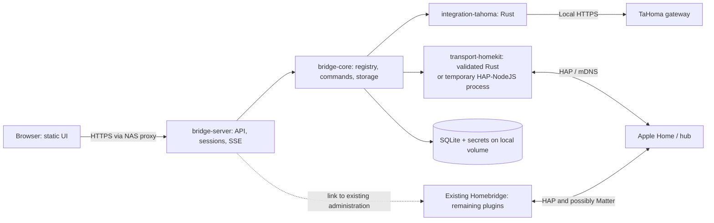

# Proposed architecture — October 17, 2026

## 1. Intended outcome

Gradually replace the household Homebridge installation with a product using less memory and CPU, without losing everyday commands or state feedback. The product provides Web administration and a bridge to Apple Home/Siri. Somfy primarily uses the TaHoma gateway already on the network.

The server and business integrations will be written in Rust. The browser UI can remain TypeScript: once compiled, it requires no Node.js process on the NAS. A Rust WebAssembly UI would add work without demonstrating server-memory savings.

This proposal covers design, work breakdown, and preparatory checks. Development, pairing, and device migration follow plan execution after review.

## 2. Known facts and outstanding checks

| Item | Current evidence | Consequence |
|---|---|---|
| Working directory | Empty except tool metadata at project start | New project, no existing codebase to preserve |
| GitHub | Authenticated as `magic5644` | Repository creation possible at P01 |
| Current UI | Owner logged in; Homebridge 2.4.0, UI 5.29.0, Node 24.21.0 | Precise comparison baseline; no update triggered |
| Observed plugin | homebridge-tahoma 2.2.64, child bridge | Preserve identity/operation during observation |
| UI accessories | 23 elements: 11 Window Covering, 2 Thermostat, 1 Garage Door Opener, 9 Switch | Heating and switch qualification are required work |
| TaHoma | Developer mDNS announcement detected | Local API available at test time |
| TaHoma API | `GET /apiVersion`: HTTP 200, TLS validated, protocol `2026.4.5-7` | Connectivity confirmed, capabilities unconfirmed |
| NAS | Owner reports QNAP TS-251+, Celeron J1900, 2 GB; UI: Ubuntu 22.04.5 x64 container | Docker amd64 priority and native QNAP `.qpkg` required; QTS version outstanding |
| Equipment | Owner reports io-homecontrol/RTS shutters and Somfy garage door | Both technologies required; garage qualification included |
| Gateway | Owner reports TaHoma V2 | Validate installed firmware capabilities, not only Switch capabilities |
| Rust HomeKit | Candidate `ewilken/hap-rs`, inspected latest commit dated April 14, 2023 | Feasibility/maintenance is a blocking milestone |

The TaHoma test used no token, read no devices, enabled no mode, and sent no command. Discovered addresses/PIN are absent from the repository. [Official Somfy API](https://github.com/Somfy-Developer/Somfy-TaHoma-Developer-Mode/blob/main/docs/openapi.yaml), [HAP candidate commit](https://github.com/ewilken/hap-rs/commit/acf45bdb00e23c81b67b3d5116c113335dc83f16).

## 3. Distinguish the products being replaced

Homebridge provides the bridge engine/plugins. The UI to reproduce is mainly `homebridge-config-ui-x`. HAP-NodeJS provides HomeKit transport. The project must cover these three responsibilities plus manufacturer APIs. Current Homebridge versions also offer Matter; actual household usage must be recorded. [Homebridge](https://github.com/homebridge/homebridge), [administration UI](https://github.com/homebridge/homebridge-config-ui-x), [HAP-NodeJS](https://github.com/homebridge/HAP-NodeJS).

Rewriting only configuration screens does not remove plugin resource usage. Removing Node.js without replacing plugins may remove devices from Home. Success is measured by the service delivered by the entire installed system and its total consumption.

## 4. Three approaches

| Approach | Benefits | Limits | Recommendation |
|---|---|---|---|
| Complete Rust replacement immediately | One runtime and control of the core | Rebuild all integrations and validate HAP before any delivery; high risk | Avoid for the first delivery |
| Gradual migration with native Rust integrations | Early Somfy optimization; Homebridge retains unmigrated devices; measurable Node removal | Temporary coexistence and possible re-pairing | **Recommended** |
| New Rust UI over unchanged Homebridge | Few integration changes | Expensive processes remain; limited memory gains | Comparison tool, not the final goal |

The gradual proposal has two independent axes: replacing integrations and selecting HomeKit transport. They have different validation criteria.

### Integration axis

- Device ownership is `legacy`, `observe`, or `native`.
- `legacy`: Homebridge retains commands and HomeKit publication.
- `observe`: Rust reads/compares; all Rust writes and HomeKit publication for that device are blocked.
- `native`: Rust commands/publishes after the corresponding Homebridge publication is disabled.
- Keep an inventory row for every device, including unmigrated cameras/alarms.
- `legacy` means retained compatibility, not a completed Rust integration.

### HomeKit axis

1. Prove a Rust HAP bridge using fictional accessories, then a pilot device.
2. If the candidate fails within the feasibility budget, temporarily use HAP-NodeJS in a separate process solely to publish Rust-controlled devices.
3. Keep existing Homebridge for other devices; the temporary HAP process runs no npm plugins.
4. Return to Rust HAP only after the same contract/hardware tests. This transition may require a new bridge and re-pairing.

The fallback retains a Node.js dependency. Do not present it as an all-Rust edition or as proven memory optimization.

## 5. Runtime architecture



Final native mode contains one Rust process and static Web files. During transition, Homebridge can remain on the NAS or another machine. Count its memory in installation measurements whenever it remains necessary.

Web/HomeKit commands follow the same path: validate capabilities/ownership → bounded admission → integration send → execution tracking → state update → Web/HomeKit notification. A manufacturer HTTP response is not a completed physical action.

## 6. Technology building blocks

Pin exact Rust/dependency versions at P02 in `Cargo.lock` and `rust-toolchain.toml`; pin frontend versions in `web/package-lock.json` when the frontend is created at P17. Families below are architectural choices, not instructions to blindly install `latest`.

| Responsibility | Proposed choice | Rationale / rule |
|---|---|---|
| Core | Stable Rust, edition 2024 | Compiled binary; no dynamic runtime for native integrations |
| Concurrency | Tokio 1 + tokio-util | Cancellable tasks, bounded channels, clean shutdown |
| Web HTTP | Axum 0.8 + tower-http | JSON API, sessions, limits, SSE in one server |
| Models | serde + serde_json; uuid | Typed contracts and persistent IDs |
| Manufacturer HTTP | reqwest with Rustls | Reused client per gateway; explicitly approved Overkiz CA |
| Discovery | mdns-sd for TaHoma | Identify through TXT, not display names |
| Data | SQLite through rusqlite, bundled SQLite | Transactions/consistent backups; no external SQL service |
| UI | Svelte 5 + TypeScript + Vite | Embedded static build; Node only for compilation |
| Styles | Simple CSS, accessible local components | No UI library for a few screens |
| HomeKit | Rust candidate evaluated at P04; HAP-NodeJS fallback | Do not reimplement HAP cryptography |
| Logs | tracing, JSON or text | Bounded/redacted logs; host-service rotation |
| CLI | clap in server binary | `serve`, `check`, `healthcheck`, `backup`, `restore`, `inventory` |
| Web auth | argon2 + opaque sessions | One initial local admin; no mandatory cloud identity |
| Tests | cargo test, HTTP simulator tests, Vitest, Playwright | Fixtures by default; real hardware separate |
| Distribution | Docker/Compose, GitHub Actions, GHCR, native archives | amd64/arm64; NAS package for actual model |

Axum, Svelte, and Docker were consulted through Context7. HTTP/SQLite operations follow their documentation: [Axum](https://docs.rs/axum/latest/axum/), [Tokio](https://tokio.rs/tokio/topics/shutdown), [Svelte](https://svelte.dev/docs/svelte/overview), [Vite](https://vite.dev/guide/static-deploy.html), [reqwest](https://docs.rs/reqwest/latest/reqwest/), [rusqlite](https://docs.rs/rusqlite/latest/rusqlite/), [mdns-sd](https://docs.rs/mdns-sd/latest/mdns_sd/).

### Planned development structure

```text
Cargo.toml                       # workspace, four members
rust-toolchain.toml
crates/bridge-core/src/           # models, rules, registry, storage, events
crates/integration-tahoma/src/    # discovery, manufacturer DTOs, HTTP, events, mappings
crates/transport-homekit/src/     # HomeKit projection and selected backend
crates/bridge-server/src/         # binary, orchestration, auth, API, UI files
web/src/                         # compiled UI
compat/hap-node/                 # created only if fallback is selected
fixtures/                        # fictional data and reproducible scenarios
tests/                           # contracts, system, performance
packaging/                       # Docker, Compose, native archive, selected NAS package
docs/                            # design, tickets, operations
```

One workspace, no core microservices. No dynamic Rust plugin system, C ABI, WASM engine, MQTT broker, or internal network bus in the first version. An integration is a compiled/tested module.

## 7. Somfy/TaHoma integration

### Connection and inventory

P10/P11 implement discovery, TLS validation, and Bearer authentication. The detected gateway does not need reactivation. Supply the token locally, never in GitHub. Any activation flow follows the current Somfy application. [Somfy guide](https://github.com/Somfy-Developer/Somfy-TaHoma-Developer-Mode).

P12 retrieves device descriptions and declared commands. Recognition combines `controllableName`, command definitions, and available states without assuming two Somfy devices have identical capabilities. Unrecognized devices remain visible with diagnostics and retain legacy support.

### Capabilities to integrate in this order

| Family | Planned native function | Publication condition |
|---|---|---|
| io coverings | Open, close, stop, position, tilt when available | Commands/state proven by fixture, then real test |
| RTS coverings | Open, close, stop; optional estimated position | Explicitly show missing measurement; calibrate estimates |
| Lights/outlets | On/off; dimming if declared | No invented percentage for binary equipment |
| Sensors | Temperature, contact, motion, other actual values | Document units/freshness |
| Two observed thermostats | Required P34: reading, setpoint, actually used modes | Verify pilot-wire heating and real versus conventional temperature |
| Somfy garage door | Required P33: actual commands/states/safety | Human validation; no invented closed/obstruction state |
| Additional gate/lock | Keep Homebridge while absent from detailed inventory | Dedicated ticket if confirmed |
| Alarms | Reading, then actually used functions | Specific tests; no automatic arming/disarming |
| Nine observed virtual switches | Required P35: qualify, then retain/replace each action | Do not assume a documented local API for stored scenarios |

RTS handling cannot turn an estimate into a measurement. Existing plugin capabilities/options provide a comparison reference, not a specification to copy blindly. [homebridge-tahoma plugin](https://github.com/dubocr/homebridge-tahoma).

The garage door is required, not an optional extension. If the gateway provides reliable state/obstruction detection, publish HomeKit GarageDoorOpener. Otherwise offer only proven distinct actions, possibly clearly named momentary buttons, and show unknown physical state. Never present cyclic control as deterministic open/close. Keep Homebridge until explicit acceptance of the selected mode; if full equivalence requires another sensor, present that dependency to the owner before migration.

UI types prove neither physical models nor state accuracy. A thermostat showing 0 °C does not justify reproducing a fake measurement. Qualify each of the nine Switch elements as a manufacturer scenario, action group, or other device. Keeping them on the child bridge is transitional; removing Homebridge requires their functional equivalence as well as coverings/garage equivalence.

### Events and executions

Use routes/verbs from the [official local specification](https://github.com/Somfy-Developer/Somfy-TaHoma-Developer-Mode/blob/main/docs/openapi.yaml). Startup takes a snapshot, installs event listening, then reconciles state. Interruptions restart this sequence with backoff. The rate/reconnection limits below are product decisions protecting the gateway.

- At most one event fetch per second per gateway; never a loop per accessory.
- An invalidated listener ID triggers registration and reconciliation.
- Read-failure backoff: 1, 2, 4, 8, 16, then 30 seconds, with ±10% jitter.
- Never automatically replay a physical command after an uncertain response or restart.
- A covering Stop request retains priority over an unsent position request.
- Mark data stale after 30 seconds without reception when the event connection has failed. An unchanged sensor does not become stale while the stream/gateway remain healthy.

### Local and cloud

Normal operation does not depend on cloud access for locally accessible capabilities. Token acquisition or some manufacturer functions may still require Somfy services. Test Internet loss separately from LAN failure.

Do not build a cloud fallback connector before finding an actual uncovered inventory need. If one exists, retain the current plugin, document the limit, and create one ticket per function; do not silently send commands through the cloud.

## 8. HomeKit bridge

HAP validation covers discovery, pairing, session verification, reads/writes, notifications, permissions, controller removal, restart persistence, and size limits. Cryptography/counters remain provided by a proven stack.

P04 has a maximum three-engineering-day budget to decide whether to retain the Rust candidate. Compiling an example is insufficient. Outcomes are `native-approved`, `sidecar-required`, or `stop-and-review` if no safe transport is available within budget. Pin any fork to a commit and maintain it explicitly instead of hiding it as a stable dependency.

Rust and Homebridge use distinct identities, directories, and ports. Allocate/persist AID/IID transactionally; renaming does not change them. Start with a conservative maximum of 149 accessories behind one bridge; beyond this, create persistent bridge groups before migrating those accessories. Homebridge child bridges remain available for coexistence. [Child Bridges](https://github.com/homebridge/homebridge/wiki/Child-Bridges).

**No promise to automatically preserve pairings, rooms, scenes, or automations.** Pair the new bridge separately. Reusing the old bridge identity requires a distinct study; copying `persist/` or Homebridge UUIDs does not guarantee it.

Matter is not in the MVP by default. If used in the household, retain its Homebridge path until explicitly planned work replaces it. A HomeKit migration must not be presented as Matter coverage.

## 9. Administration UI

| Screen | First delivery | Conditional evolution |
|---|---|---|
| Home | Health, service memory, TaHoma connection, device coverage | Historical version comparison |
| Initial setup | Local account, TaHoma connection, TLS test, inventory | Per-device migration assistant |
| Devices | List, capabilities, state, freshness, ownership; authorized controls | Model-specific settings |
| HomeKit | Bridge state, restricted QR/PIN, published accessories | Multiple bridges above 149 accessories |
| Integrations | Native TaHoma and link to remaining Homebridge | One entry per actual integration |
| Logs | Simple filter, bounded window, redacted download | Occasional manufacturer diagnostics |
| Settings | Network, data, backup, restore | Installer-guided updates |
| Migration | Native/legacy coverage, checklist, difference report | Automation reconstruction assistance |

Third-party plugin forms stay in existing Homebridge UI until replaced. The product does not advertise a universal npm plugin marketplace. The core provides no remote terminal.

The UI is French, keyboard-accessible, and mobile-friendly. Icon-only controls have labels, errors link to fields, and physical movement is not hidden behind ambiguous buttons. All project documentation is English.

## 10. Configuration, storage, and operational security

- Versioned declarative `config.json`, updated through temporary write, synchronization, and atomic replacement; keep secrets separate.
- SQLite on a local volume, never SMB/NFS. One connection owned by a dedicated worker with a bounded queue; no blocking SQLite query in an async handler.
- Backups use SQLite's backup API and a manifest. Never archive only the main file of a database being written.
- Secrets/pairing keys: private directory, 0700/0600 permissions. At-rest encryption may use the NAS encrypted volume; do not claim protection from a NAS administrator.
- Ordinary backups exclude secrets and list values to reenter. Full recovery backups only through local CLI to a 0600 file; no complete Web export.
- One local administrator, Argon2id password, opaque HttpOnly/SameSite cookie session, Secure cookie under HTTPS, logout invalidation, CSRF protection, and Origin validation for writes.
- First login: one-time CLI-generated setup code expiring after 10 minutes. No default password.
- Default API listen `127.0.0.1:8582`, HTTPS through NAS reverse proxy. LAN HTTP exposure requires an explicit operator choice; it is not used for secret tests.
- Trust forwarded headers only from a configured proxy address. No global `X-Forwarded-*` trust.
- TaHoma connections validate CA/DNS name, block redirects, and ignore system proxies. A manual IP must not disable name validation; use host→IP resolution preserving the validated TLS name.
- Rate-limit/validate API writes; no bodies, cookies, tokens, or HomeKit PINs in logs. Anonymize test snapshots before committing.

## 11. Docker and native installation

### Docker priority path

Image `ghcr.io/magic5644/homebridge-rust`, immutable versions/digests, `linux/amd64` and `linux/arm64`. Multistage image, configurable numeric user, dropped capabilities, read-only root, `/data` volume, bounded temporary storage. No Docker socket mount or `privileged: true`.

On Linux NAS, `network_mode: host` enables required local traffic without multicast port NAT; it shares host networking, so ports must be free. Administration remains on the configured listen address. Do not add `ports:`. Validate multicast, IPv6, multiple interfaces, and firewall behavior on the actual NAS. [Docker host networking](https://docs.docker.com/engine/network/drivers/host/).

Proposed initial ports: UI `8582/TCP`, HAP `51827/TCP`, mDNS `5353/UDP` shared with system mechanisms; TaHoma uses an outbound connection. Record actual Homebridge/child-bridge ports before installation. Do not stop Avahi or another service to free 5353.

A local healthcheck distinguishes a live process from degraded integrations: an offline gateway must not cause a container restart loop. HAP-NodeJS fallback uses a separate Compose profile and reports its own consumption.

### Direct installation

Deliver a signed or checksummed native archive containing the binary/embedded UI. Prioritize Linux x86_64/arm64; musl is an option to validate, not a universal portability guarantee. Check native dependencies, kernel, and mDNS resolution on the NAS.

The identified NAS requires **QNAP `.qpkg` x86_64**, built with QDK and tested on the installed QTS version. The QPKG wrapper handles start/stop/restart/update and preserves the data directory; after necessary privileged installation operations, the daemon runs under a service account. Do not assume systemd or publish a Synology package in this work. [QDK](https://github.com/qnap-dev/QDK), [QDK guide](https://github.com/qnap-dev/QDK/blob/master/docs/QDK-Developer-Guide.md).

Use a generic x86_64 CPU target, not build-machine `target-cpu=native`. Validate cryptographic providers/CPU instructions on the Celeron J1900. Build off-NAS to avoid consuming its 2 GB. UI-reported available memory describes host/container according to the tool, not Homebridge RSS; it does not replace per-process baselines. [QNAP specifications](https://www.qnap.com/en/product/ts-251%2B/specs/hardware).

Installation requires no Rust, npm, or NAS compilation. Node fallback supplies its runtime separately and documents the difference. Add 32-bit ARM only if the NAS requires it; lack of support may require hardware replacement.

## 12. Measurements and acceptance criteria

The following are **proposed targets for decision after baseline**, not results. Compare identical hardware, device counts, functions, and scenarios. Identify errors before comparing speed: removing expensive devices from the test is not a product gain.

| Measurement | Initial native target | Method |
|---|---|---|
| Idle memory, 50 simulated devices | RSS ≤ 64 MiB | Release, 10 min warmup, 30 min measurement |
| Idle memory, 100 simulated devices | RSS ≤ 128 MiB | Same protocol; include required bridges |
| Gain on migrated real installation | Proposed memory reduction ≥ 50%, to evaluate | Sum required-process PSS; otherwise RSS with double-counting caveat |
| Idle CPU | < 1% of one core on average | 10 min, excluding state changes |
| Local API, cached data | p95 < 100 ms | 1,000 reads, 5 clients, excluding radio cost |
| Command admission | p95 < 100 ms | Admission response, separate from physical movement |
| API startup | < 5 s | API may be ready with degraded integration |
| Endurance | 72 h without crash; memory plateau | Compare first/last 24 h medians after warmup; drift < 10% |
| Robustness | Recovery after network loss/gateway reboot | No double-send or identifier loss |

For Docker, also report cgroup `memory.current`/peak including cache separately from RSS/PSS; these metrics are not directly comparable. Include every sidecar and retained Homebridge. The hybrid profile may initially consume more; decide from measurements rather than language choice.

Measure movement delays, radio stability, and RTS physical limits separately. Target 100% retention of inventoried use cases, not a claim of 100% native device coverage in the first version.

## 13. Migration and rollback

1. Inventory versions, plugins, accessories, hubs, Matter, and critical automations.
2. Create/verify a complete backup of the current installation privately.
3. Deploy on different ports/volume; begin in `observe`.
4. Compare states for at least 24 h for one io and one RTS covering when both exist.
5. Choose a pilot without safety functions, prepare re-pairing, record affected automations.
6. Disable only its legacy publication, verify no duplicate, enable `native`, and pair the new bridge.
7. Test Apple Home, Siri, wall button, remote, feedback, and network failure. Missing RTS feedback stays visible.
8. Migrate by family after 72 stable hours; update actual coverage at every step.
9. On failure, block Rust writes/publication, restore saved legacy configuration and the Homebridge path. Recreate Home associations if deleted.
10. Remove a plugin, then Node.js, only when no inventory row depends on it and after a final backup.

Real-device migration, production restoration, pairing, and command activation require a window agreed with the owner. Agents may autonomously prepare/test these operations on simulators.

## 14. Deferred scope and triggers

| Topic | Trigger for additional work |
|---|---|
| Non-Somfy connector | Present in inventory and need to remove its plugin |
| Native MQTT/Zigbee/Z-Wave/BLE | Actual hardware present; retain existing coordinator meanwhile |
| Cameras, video, audio, TV | Device present and protocol requiring replacement; FFmpeg may dominate resources |
| Native Matter | Confirmed use and decision to replace this path |
| Multiple bridges | More than 149 exposed devices or measured isolation requirement |
| New internal scheduler | Need beyond the nine actions covered by P35; avoid duplicating TaHoma/Home automations |
| Automatic updates | After proven backup/restore and schema compatibility |
| Mobile app / remote access | Separate request; local responsive UI is initially sufficient |

Deferral removes no existing use case: retain its Homebridge path until the replacing work is delivered.

## 15. Milestones and indicative effort

Engineering estimates to recalibrate after inventory/P04. Luna accelerates bounded work but does not replace hardware testing or HAP/security review.

| Milestone | Verifiable output | Indicative effort |
|---|---|---|
| M0 — inventory/decisions | Hardware, baseline, coverage, HAP decision | 3–5 days |
| M1 — usable baseline | Authenticated API, storage, simulator | 4–7 days |
| M2 — local Somfy | Tested inventory/events/commands | 5–8 days |
| M3 — HomeKit/UI | End-to-end test control | 5–10 days |
| M4 — NAS | Docker, selected native installation, tested restore | 4–7 days |
| M5 — real pilot | Validation and 72 h stability | 4–6 calendar days |
| M6 — other devices | One work package per actual plugin/family | Estimate after inventory |

For Somfy/NAS, roughly 5–9 weeks with regular human availability. Substantial Rust HAP work may add weeks or require fallback. Whole-house replacement cannot be estimated before inventory.
