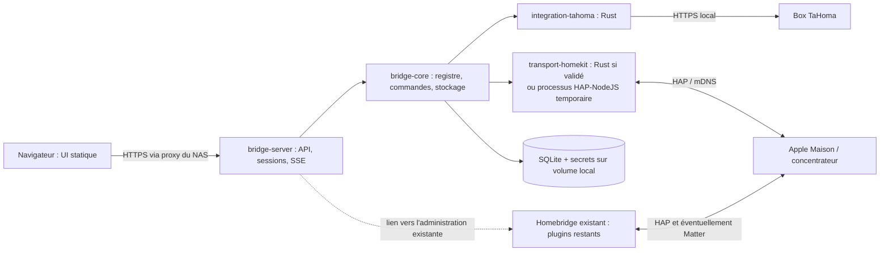

# Architecture proposée — 17 octobre 2026

## 1. Résultat recherché

Remplacer progressivement l'installation Homebridge domestique par un produit consommant moins de mémoire et de CPU, sans perdre les commandes et états utilisés au quotidien. Le produit expose une administration Web et un pont vers Apple Maison/Siri. Somfy passe prioritairement par la box TaHoma présente sur le réseau.

Le serveur et les intégrations métier seront écrits en Rust. L'interface navigateur peut rester en TypeScript : elle ne nécessite aucun processus Node.js sur le NAS une fois compilée. Une interface WebAssembly en Rust ajouterait du travail sans démontrer un gain de mémoire du serveur.

Cette proposition comprend la conception, le découpage et les vérifications préparatoires. Le développement, l'appairage et la bascule des équipements feront l'objet de l'exécution du plan après revue.

## 2. Ce qui est connu et ce qui reste à vérifier

| Élément | Preuve actuelle | Conséquence |
|---|---|---|
| Dossier de travail | Vide, hors métadonnées d'outil | Nouveau projet, aucune base à préserver |
| GitHub | Session authentifiée en tant que `magic5644` | Création du dépôt possible au lot P01 |
| Interface actuelle | Session ouverte par le propriétaire ; Homebridge 2.4.0, UI 5.29.0, Node 24.21.0 | Base de comparaison précise ; aucune mise à jour déclenchée |
| Plugin observé | homebridge-tahoma 2.2.64, exécuté comme child bridge | Conserver son identité et son fonctionnement pendant l'observation |
| Accessoires visibles dans l'UI | 23 éléments : 11 Window Covering, 2 Thermostat, 1 Garage Door Opener, 9 Switch | Chauffage et qualification des interrupteurs inclus dans les lots requis |
| TaHoma | Annonce mDNS développeur détectée | API locale disponible au moment du test |
| API TaHoma | `GET /apiVersion` : HTTP 200, TLS validé, protocole `2026.4.5-7` | Connectivité locale confirmée, capacités non confirmées |
| NAS | QNAP TS-251+, Celeron J1900, 2 Go selon le propriétaire ; UI : conteneur Ubuntu 22.04.5, x64 | Docker amd64 prioritaire et paquet natif QNAP `.qpkg` requis ; version QTS à relever |
| Équipements | Volets roulants io-homecontrol et RTS, porte de garage Somfy selon le propriétaire | Deux technologies obligatoires ; garage inclus dans le plan avec qualification spécifique |
| Box | TaHoma V2 selon le propriétaire | Valider les capacités du firmware présent, pas seulement celles d'une Switch |
| HomeKit Rust | Candidat `ewilken/hap-rs`, dernier commit consulté du 14 avril 2023 | Faisabilité et maintenance constituent un jalon bloquant |

Le test TaHoma n'a pas utilisé de jeton, lu les équipements, activé de mode ou envoyé de commande. Les coordonnées et le PIN découverts ne figurent pas dans le dépôt. [API Somfy officielle](https://github.com/Somfy-Developer/Somfy-TaHoma-Developer-Mode/blob/main/docs/openapi.yaml), [commit du candidat HAP](https://github.com/ewilken/hap-rs/commit/acf45bdb00e23c81b67b3d5116c113335dc83f16).

## 3. Ne pas confondre les produits à remplacer

Homebridge fournit le moteur de pont et les plugins. L'interface à reproduire est principalement `homebridge-config-ui-x`. HAP-NodeJS fournit le transport HomeKit. Le projet doit donc couvrir ces trois responsabilités, plus les API des fabricants. Les versions actuelles de Homebridge proposent également Matter ; sa présence dans l'installation devra être relevée. [Homebridge](https://github.com/homebridge/homebridge), [interface d'administration](https://github.com/homebridge/homebridge-config-ui-x), [HAP-NodeJS](https://github.com/homebridge/HAP-NodeJS).

Réécrire uniquement l'écran de configuration ne supprime pas la consommation des plugins. À l'inverse, supprimer Node.js sans remplacer les plugins peut supprimer des équipements de Maison. Le critère de réussite est le service rendu par l'ensemble installé, avec sa consommation totale.

## 4. Trois approches

| Approche | Atouts | Limites | Avis |
|---|---|---|---|
| Remplacement intégral en Rust dès le départ | Un seul runtime et maîtrise du cœur | Refaire toutes les intégrations et valider HAP avant toute livraison ; risque élevé | À éviter comme première livraison |
| Migration progressive avec intégrations natives Rust | Somfy optimisé tôt ; Homebridge conserve les équipements non migrés ; retrait de Node mesurable | Coexistence temporaire et réappairages possibles | **Recommandée** |
| Nouvelle UI Rust devant Homebridge inchangé | Peu de modifications des intégrations | Les processus coûteux subsistent ; gain mémoire limité | Outil de comparaison, pas objectif final |

La proposition progressive utilise deux axes indépendants : remplacement des intégrations et choix du transport HomeKit. Ils ont des critères de validation différents.

### Axe intégrations

- Un équipement est possédé par `legacy`, `observe` ou `native`.
- `legacy` : Homebridge conserve ses commandes et sa publication HomeKit.
- `observe` : Rust lit et compare ; toutes ses écritures et sa publication HomeKit pour cet équipement sont bloquées.
- `native` : Rust commande et publie après désactivation de la publication correspondante dans Homebridge.
- L'inventaire doit garder une ligne pour chaque appareil, y compris une caméra ou une alarme non migrée.
- L'état `legacy` est une compatibilité conservée, pas une intégration Rust réalisée.

### Axe HomeKit

1. Prouver un pont HAP Rust sur des accessoires fictifs, puis sur un équipement pilote.
2. Si le candidat échoue au budget de faisabilité, utiliser temporairement HAP-NodeJS dans un processus séparé, uniquement pour publier les équipements Rust.
3. Conserver le Homebridge existant pour les autres appareils ; le processus HAP temporaire n'exécute aucun plugin npm.
4. Revenir au transport HAP Rust seulement après les mêmes tests de contrat et de matériel. Cette transition peut imposer un nouveau pont et un réappairage.

Le repli conserve une dépendance Node.js. Il ne doit pas être présenté comme une édition entièrement Rust, ni comme une optimisation mémoire acquise.

## 5. Architecture d'exécution



Le mode natif final contient un processus Rust et des fichiers Web statiques. Pendant la transition, Homebridge peut continuer sur le NAS ou sur une autre machine. Sa mémoire compte dans les mesures de l'installation si elle y est nécessaire.

Une commande Web ou HomeKit suit le même chemin : validation des capacités et de la propriété → admission bornée → envoi à l'intégration → suivi de l'exécution → mise à jour de l'état → notification Web/HomeKit. Un retour HTTP du fabricant n'est pas assimilé à une action physique terminée.

## 6. Briques technologiques

Versions exactes figées au ticket P02 dans `Cargo.lock`, `rust-toolchain.toml` et `web/package-lock.json`. Les familles ci-dessous sont des choix d'architecture, pas une instruction d'installer aveuglément la version `latest`.

| Responsabilité | Choix proposé | Justification / règle |
|---|---|---|
| Cœur | Rust stable, édition 2024 | Binaire compilé ; pas de runtime dynamique pour les intégrations natives |
| Concurrence | Tokio 1 + tokio-util | Tâches annulables, canaux bornés, arrêt propre |
| HTTP Web | Axum 0.8 + tower-http | API JSON, sessions, limites et SSE dans le même serveur |
| Modèles | serde + serde_json ; uuid | Contrats typés et identifiants persistants |
| HTTP fabricant | reqwest avec Rustls | Un client réutilisé par box ; CA Overkiz explicitement approuvée |
| Découverte | mdns-sd pour TaHoma | Identification par TXT, pas par nom d'affichage |
| Données | SQLite via rusqlite, SQLite embarqué | Transactions et sauvegarde cohérente ; pas de service SQL externe |
| UI | Svelte 5 + TypeScript + Vite | Build statique embarqué ; Node uniquement pour compiler |
| Styles | CSS simple, composants locaux accessibles | Pas de bibliothèque UI pour quelques écrans |
| HomeKit | Candidat Rust évalué au P04 ; HAP-NodeJS en repli | Ne pas réimplémenter soi-même la cryptographie HAP |
| Logs | tracing, sortie JSON ou texte | Journaux bornés et expurgés ; rotation par le service hôte |
| CLI | clap dans le binaire serveur | `serve`, `check`, `healthcheck`, `backup`, `restore`, `inventory` |
| Auth Web | argon2 + sessions opaques | Un compte administrateur initial ; aucune identité cloud obligatoire |
| Tests | cargo test, tests HTTP avec simulateur, Vitest et Playwright | Fixtures par défaut ; matériel réel séparé |
| Distribution | Docker/Compose, GitHub Actions, GHCR, archives natives | amd64 et arm64 ; paquet NAS selon modèle réel |

Axum, Svelte et Docker ont été consultés via Context7. Les opérations HTTP et SQLite suivent leurs documentations : [Axum](https://docs.rs/axum/latest/axum/), [Tokio](https://tokio.rs/tokio/topics/shutdown), [Svelte](https://svelte.dev/docs/svelte/overview), [Vite](https://vite.dev/guide/static-deploy.html), [reqwest](https://docs.rs/reqwest/latest/reqwest/), [rusqlite](https://docs.rs/rusqlite/latest/rusqlite/), [mdns-sd](https://docs.rs/mdns-sd/latest/mdns_sd/).

### Structure prévue, à créer au développement

```text
Cargo.toml                       # workspace, quatre membres
rust-toolchain.toml
crates/bridge-core/src/           # modèles, règles, registre, stockage, événements
crates/integration-tahoma/src/    # découverte, DTO fabricant, HTTP, événements, mappings
crates/transport-homekit/src/     # projection HomeKit et backend retenu
crates/bridge-server/src/         # binaire, orchestration, auth, API, fichiers UI
web/src/                         # interface compilée
compat/hap-node/                 # créé uniquement si le repli est retenu
fixtures/                        # données fictives et scénarios reproductibles
tests/                           # contrats, système, performances
packaging/                       # Docker, Compose, archive native et paquet NAS retenu
docs/                            # conception, tickets, exploitation
```

Un seul workspace, pas de microservices pour le cœur. Pas de système de plugins dynamiques Rust, d'ABI C, de moteur WASM, de broker MQTT ou de bus réseau interne dans la première version. Une intégration est un module compilé et testé.

## 7. Intégration Somfy/TaHoma

### Connexion et inventaire

P10 et P11 implémentent la découverte, la validation TLS et l'authentification Bearer. La box déjà détectée n'a pas besoin d'être réactivée. Le jeton sera renseigné localement, jamais dans GitHub. Le parcours d'activation éventuel doit suivre l'application Somfy actuelle. [Guide Somfy](https://github.com/Somfy-Developer/Somfy-TaHoma-Developer-Mode).

P12 récupère la description des appareils et leurs commandes déclarées. La reconnaissance combine `controllableName`, définition des commandes et états disponibles, sans présumer que deux appareils Somfy ont les mêmes capacités. Les appareils non reconnus restent visibles avec un diagnostic et conservent leur prise en charge historique.

### Capacités à intégrer dans cet ordre

| Famille | Fonction native prévue | Condition de publication |
|---|---|---|
| Volets/stores io | Ouvrir, fermer, arrêter, position, inclinaison si disponible | Commande et état prouvés par fixture puis test réel |
| Volets/stores RTS | Ouvrir, fermer, arrêter ; position estimée optionnelle | Affichage explicite de l'absence de mesure ; calibration si estimation |
| Lumières/prises | Marche/arrêt ; variation si déclarée | Aucun pourcentage inventé pour un équipement binaire |
| Capteurs | Température, contact, mouvement et autres valeurs réellement présentes | Unités et fraîcheur documentées |
| Deux thermostats observés | Lot obligatoire P34 : lecture, consigne et modes effectivement utilisés | Vérifier s'il s'agit de chauffage à fil pilote et d'une température réelle ou conventionnelle |
| Porte de garage Somfy | Lot obligatoire P33 : commandes et états/sécurités réellement disponibles | Validation humaine ; aucun état de fermeture ou obstacle inventé |
| Portail/serrure supplémentaires | Conserver Homebridge tant qu'absents de l'inventaire détaillé | Ticket dédié si besoin confirmé |
| Alarmes | Lecture puis fonctions effectivement utilisées | Tests spécifiques ; pas d'armement/désarmement automatique |
| Neuf interrupteurs virtuels observés | Lot obligatoire P35 : qualifier puis conserver/remplacer chaque action | Ne pas supposer une API locale documentée de lancement des scénarios stockés |

Le traitement RTS ne peut pas transformer une estimation en mesure. Les capacités et options du plugin existant sont une référence de comparaison, pas une spécification à copier aveuglément. [Plugin homebridge-tahoma](https://github.com/dubocr/homebridge-tahoma).

La porte de garage est un livrable requis, pas une extension facultative. Si la box fournit des états et une détection d'obstacle fiables, publier le service HomeKit GarageDoorOpener. Sinon, proposer uniquement les actions distinctes prouvées, éventuellement comme boutons momentanés clairement nommés, et afficher l'état physique inconnu. Une commande cyclique ne doit jamais être présentée comme une commande déterministe ouvrir/fermer. Le chemin Homebridge reste actif jusqu'à l'acceptation explicite du mode retenu ; si une équivalence complète exige un capteur supplémentaire, cette dépendance est présentée au propriétaire avant migration.

Les types affichés par l'UI ne prouvent ni le modèle physique ni la précision des états. Un thermostat affichant 0 °C ne justifie pas de reproduire une fausse mesure. Les neuf Switch doivent chacun être identifiés comme scénario fabricant, groupe d'actions, ou autre équipement. Leur maintien sur le child bridge est une étape de transition ; retirer Homebridge exige leur équivalence fonctionnelle, en plus de celle des volets et du garage.

### Événements et exécutions

Le client utilisera les routes et verbes définis dans la [spécification locale officielle](https://github.com/Somfy-Developer/Somfy-TaHoma-Developer-Mode/blob/main/docs/openapi.yaml). Le démarrage prend un instantané, installe l'écoute des événements puis réconcilie l'état. Les interruptions relancent cette séquence avec temporisation. Les limites de fréquence et de reconnexion ci-dessous sont des décisions du produit visant à protéger la box.

- Au plus une récupération d'événements par seconde, par box ; jamais une boucle par accessoire.
- Un identifiant d'écoute invalidé entraîne une nouvelle inscription et une réconciliation.
- Temporisation des lectures sur panne : 1, 2, 4, 8, 16 puis 30 secondes, avec dispersion de ±10 %.
- Aucune commande physique n'est rejouée automatiquement après une réponse incertaine ou un redémarrage.
- L'arrêt demandé à un volet doit rester prioritaire sur une position encore en attente d'envoi.
- Une donnée non reçue depuis 30 secondes est marquée périmée lorsque la liaison d'événements est défaillante. Un capteur simplement inchangé ne devient pas périmé si le flux et la box restent sains.

### Local et cloud

Le profil normal ne dépend pas du cloud pour piloter les capacités accessibles localement. L'obtention d'un jeton ou certaines fonctions fabricant peuvent encore dépendre du service Somfy. Une indisponibilité d'Internet sera testée séparément d'une panne LAN.

Ne pas développer un connecteur cloud de secours avant d'avoir trouvé un besoin réel non couvert dans l'inventaire. Si ce besoin existe, conserver le plugin actuel, documenter la limite et créer un ticket par fonction ; ne pas envoyer silencieusement les commandes dans le cloud.

## 8. Pont HomeKit

La validation HAP couvre : découverte réseau, appairage, vérification des sessions, lectures/écritures, notifications, permissions, suppression d'un contrôleur, persistance après redémarrage et limites de taille. Les calculs cryptographiques et la gestion des compteurs restent fournis par une pile éprouvée.

P04 bénéficie de trois jours d'ingénierie maximum pour décider si le candidat Rust peut être retenu. Compiler un exemple ne suffit pas. Les sorties possibles sont `native-approved`, `sidecar-required` ou `stop-and-review` si aucun transport sûr n'est disponible dans le budget. Le fork éventuel est épinglé à un commit et entretenu explicitement, pas masqué comme une dépendance stable.

Le service Rust et Homebridge ont des identités, répertoires et ports distincts. Les AID/IID sont alloués et persistés transactionnellement ; un renommage ne les modifie pas. On démarre avec un maximum prudent de 149 accessoires derrière un pont ; si l'inventaire dépasse ce nombre, il faut créer des groupes de ponts persistants avant de migrer ces accessoires. Les child bridges Homebridge restent utilisables pour la coexistence. [Child Bridges](https://github.com/homebridge/homebridge/wiki/Child-Bridges).

**Aucune promesse de conservation automatique des appairages, pièces, scènes ou automatisations.** Le nouveau pont est appairé séparément. Toute reprise de l'identité du pont existant nécessiterait une étude distincte ; copier `persist/` ou les UUID Homebridge ne la garantit pas.

Matter n'est pas ajouté au MVP par défaut. S'il est utilisé dans la maison, le chemin correspondant reste sur Homebridge jusqu'à un lot explicitement planifié. Cela évite de faire passer une migration HomeKit pour une couverture Matter.

## 9. Interface d'administration

| Écran | Première livraison | Évolution conditionnelle |
|---|---|---|
| Accueil | Santé, mémoire du service, liaison TaHoma, couverture des appareils | Comparaison historique des versions |
| Configuration initiale | Compte local, connexion TaHoma, test TLS, inventaire | Assistant de migration équipement par équipement |
| Appareils | Liste, capacités, état, fraîcheur, propriétaire ; commandes autorisées | Réglages spécifiques aux modèles rencontrés |
| HomeKit | État du pont, QR/PIN à accès restreint, liste des accessoires publiés | Plusieurs ponts si inventaire supérieur à 149 |
| Intégrations | TaHoma native et lien vers Homebridge restant | Une fiche par intégration réellement ajoutée |
| Journaux | Filtre simple, fenêtre bornée et téléchargement expurgé | Diagnostics fabricant ponctuels |
| Paramètres | Réseau, données, sauvegarde et restauration | Mise à jour guidée par le gestionnaire d'installation |
| Migration | Couverture native/legacy, checklist, rapport de différences | Aide à la reconstruction des automatisations |

Les formulaires de plugins tiers restent dans l'UI Homebridge existante tant qu'ils ne sont pas remplacés. Le nouveau produit n'annonce pas une boutique universelle de plugins npm. Le noyau ne fournit pas de terminal distant.

UI en français, utilisable au clavier et sur mobile. Les icônes seules ont un libellé, les erreurs sont reliées aux champs et le mouvement physique n'est pas caché derrière un bouton ambigu.

## 10. Configuration, stockage et sécurité opérationnelle

- Configuration déclarative versionnée dans `config.json`, mise à jour par écriture temporaire, synchronisation et remplacement atomique ; séparer les secrets.
- SQLite sur un volume local, jamais sur SMB/NFS. Une connexion détenue par un worker dédié, avec une file bornée ; aucune requête SQLite bloquante dans un handler async.
- Les sauvegardes utilisent l'API de sauvegarde SQLite et un manifeste. Ne jamais archiver seulement le fichier principal d'une base en écriture.
- Secrets et clés d'appairage : répertoire privé, permissions 0700/0600. Le chiffrement au repos pourra utiliser le volume chiffré du NAS ; aucune prétention de protection contre un administrateur du NAS.
- Sauvegarde ordinaire sans secrets, avec liste des éléments à ressaisir. Sauvegarde de récupération complète uniquement via CLI locale vers un fichier 0600 ; aucun export complet sur une route Web.
- Un compte administrateur local, mot de passe Argon2id, session opaque en cookie HttpOnly/SameSite, cookie Secure en HTTPS, invalidation à la déconnexion, protection CSRF et vérification Origin sur les écritures.
- Première connexion : code d'installation à usage unique créé par CLI et expirant après 10 minutes. Aucun mot de passe prédéfini.
- API sur `127.0.0.1:8582` par défaut, HTTPS via le reverse proxy du NAS. Une exposition HTTP au LAN nécessite un choix explicite de l'exploitant ; elle n'est pas utilisée pour les tests de secrets.
- Le proxy ne contrôle les en-têtes transférés que depuis une adresse configurée. Aucune confiance globale envers `X-Forwarded-*`.
- La connexion TaHoma valide la CA et le nom DNS, bloque les redirections et n'utilise pas les proxies système. Une IP manuelle ne doit pas désactiver la vérification du nom ; utiliser une résolution hôte→IP conservant le nom TLS validé.
- Écritures API limitées et validées ; pas de corps, cookies, jetons ou PIN HomeKit dans les logs. Les instantanés de test sont anonymisés avant versionnement.

## 11. Installation Docker et native

### Docker, voie prioritaire

Image `ghcr.io/magic5644/homebridge-rust`, versions immuables et digests, `linux/amd64` et `linux/arm64`. Image multiétage, utilisateur numérique configurable, capacités supprimées, racine en lecture seule, volume `/data` et espace temporaire borné. Aucun socket Docker monté, aucun `privileged: true`.

Sur NAS Linux, `network_mode: host` permet le trafic local nécessaire sans NAT de ports multicast ; il partage le réseau de l'hôte et les ports doivent donc être libres. L'administration reste sur l'adresse d'écoute configurée. Ne pas ajouter `ports:` à cette configuration. Le fonctionnement avec multicast, IPv6, interfaces multiples et pare-feu se valide sur le NAS réel. [Réseau host Docker](https://docs.docker.com/engine/network/drivers/host/).

Ports initiaux proposés : UI `8582/TCP`, HAP `51827/TCP`, mDNS `5353/UDP` partagé avec les mécanismes du système ; TaHoma est une connexion sortante. Les ports réellement utilisés par Homebridge et les child bridges sont relevés avant installation. Ne pas arrêter Avahi ou un service existant pour libérer 5353.

Un healthcheck local distingue processus vivant et intégrations dégradées : une box hors ligne ne doit pas déclencher une boucle de redémarrages du conteneur. Le repli HAP-NodeJS utilise un profil Compose séparé et affiche sa consommation propre.

### Installation directe

Livrer une archive native signée ou accompagnée de sommes de contrôle, contenant le binaire et l'UI embarquée. Priorité aux cibles Linux x86_64/arm64 ; musl est une option à valider, pas une garantie de portabilité universelle. Les dépendances natives, le noyau et la résolution mDNS sont vérifiés sur le NAS.

Le NAS cible étant identifié, le format requis est **QNAP `.qpkg` x86_64**, créé avec QDK et testé sur la version QTS réellement installée. Le wrapper QPKG gère démarrage, arrêt, redémarrage, mise à jour et conservation du répertoire de données ; le daemon tourne sous un compte de service après les opérations d'installation privilégiées nécessaires. Ne pas supposer la présence de systemd ni publier de paquet Synology dans ce lot. [QDK](https://github.com/qnap-dev/QDK), [guide QDK](https://github.com/qnap-dev/QDK/blob/master/docs/QDK-Developer-Guide.md).

Le binaire x86_64 utilise une cible CPU générique : pas de `target-cpu=native` issu du poste de compilation. Les choix de fournisseur cryptographique et d'instructions CPU sont validés sur le Celeron J1900. Construire hors du NAS évite de consommer sa mémoire de 2 Go. Une mémoire disponible affichée dans l'UI représente l'hôte/conteneur selon l'outil, pas le RSS de Homebridge ; elle ne remplace pas une baseline par processus. [Caractéristiques QNAP](https://www.qnap.com/en/product/ts-251%2B/specs/hardware).

L'installation n'exige ni Rust, ni npm, ni compilation sur le NAS. Le profil de repli Node fournit son runtime séparément et documente cette différence. ARM 32 bits n'est ajouté que si le NAS l'impose ; son absence peut rendre un remplacement matériel nécessaire.

## 12. Mesures et critères d'acceptation

Les chiffres suivants sont des **cibles proposées pour décision après baseline**, pas des résultats. Même matériel, même nombre d'appareils, mêmes fonctions et mêmes scénarios pour la comparaison. Identifier les erreurs avant de comparer la vitesse : retirer les équipements lourds du test ne constitue pas un gain du produit.

| Mesure | Cible native de départ | Méthode |
|---|---|---|
| Mémoire au repos, 50 appareils simulés | RSS ≤ 64 Mio | Release, échauffement 10 min, mesure 30 min |
| Mémoire au repos, 100 appareils simulés | RSS ≤ 128 Mio | Même protocole ; inclure les ponts requis |
| Gain sur installation réelle migrée | Réduction mémoire ≥ 50 % à évaluer | Somme PSS des processus requis ; à défaut RSS en signalant le double comptage |
| CPU au repos | < 1 % d'un cœur moyen | Mesure 10 min, hors changement d'état |
| API locale sur données en cache | p95 < 100 ms | 1 000 lectures, 5 clients, sans coût radio |
| Admission d'une commande | p95 < 100 ms | Réponse d'admission, distincte du déplacement physique |
| Démarrage API | < 5 s | L'API peut être prête avec l'intégration dégradée |
| Fonctionnement prolongé | 72 h sans crash ; plateau mémoire | Comparer les médianes des 24 premières/dernières heures après échauffement ; dérive < 10 % |
| Robustesse | Reprise après panne réseau et reboot box | Pas de double envoi ni perte d'identifiants |

Pour Docker, publier aussi `memory.current`/pic du cgroup avec cache, séparément des RSS/PSS : ces métriques ne se comparent pas directement. Inclure tout sidecar et tout Homebridge restant. Le profil hybride peut consommer davantage au début ; on décide de le poursuivre sur des mesures, pas sur le langage.

Délais de déplacement, stabilité radio et limite physique RTS sont mesurés séparément. L'objectif de couverture est 100 % des usages inventoriés conservés, et non 100 % des appareils annoncés nativement dès la première version.

## 13. Migration et retour arrière

1. Inventorier versions, plugins, accessoires, concentrateurs, Matter et automatisations critiques.
2. Créer puis vérifier une sauvegarde complète de l'installation actuelle dans un emplacement privé.
3. Déployer la nouvelle application sur d'autres ports et un autre volume ; commencer en `observe`.
4. Comparer au moins 24 h les états d'un volet io et d'un RTS si ces deux technologies sont présentes.
5. Choisir un équipement sans fonction de sécurité pour le pilote, préparer son réappairage et noter les automatisations touchées.
6. Désactiver uniquement sa publication historique, vérifier l'absence de doublon, puis activer `native` et appairer le nouveau pont.
7. Vérifier app Maison, Siri, bouton mural, télécommande, retour d'état et panne réseau. Une perte de retour RTS doit rester visible.
8. Migrer par famille après 72 h stables ; remplir la couverture réelle à chaque étape.
9. En cas d'échec, bloquer les écritures/publications Rust, remettre la configuration historique sauvegardée et restaurer le chemin Homebridge. Recréer les associations Maison si elles ont été supprimées.
10. Retirer un plugin puis Node.js seulement quand plus aucune ligne d'inventaire n'en dépend, et après une sauvegarde finale.

La migration d'appareils réels, la restauration de production, l'appairage et l'activation des commandes nécessitent une fenêtre décidée avec le propriétaire. Les agents peuvent préparer et tester ces opérations sur simulateur en autonomie.

## 14. Périmètre reporté et déclencheurs

| Sujet | Déclencheur d'un lot supplémentaire |
|---|---|
| Connecteur non Somfy | Présence dans l'inventaire et besoin de retirer son plugin |
| MQTT/Zigbee/Z-Wave/BLE natifs | Matériel réellement présent ; conserver le coordinateur existant d'ici là |
| Caméras, vidéo, audio, TV | Équipement présent et protocole à remplacer ; FFmpeg peut dominer les ressources |
| Matter natif | Usage actuel confirmé et décision de remplacer ce chemin |
| Plusieurs ponts | Plus de 149 appareils à exposer ou exigence d'isolation mesurée |
| Nouveau planificateur interne | Besoin distinct des neuf actions existantes, couvertes par P35 ; éviter de dupliquer les automatismes TaHoma/Maison |
| Mises à jour automatiques | Après sauvegarde/restauration et compatibilité de schéma prouvées |
| Application mobile / accès distant | Demande distincte ; interface responsive locale suffisante au départ |

Ces reports ne retirent aucun usage existant : ils conservent son chemin Homebridge jusqu'au lot qui le remplace.

## 15. Jalons et charge indicative

Estimation d'ingénierie, à recalibrer après inventaire et P04. Les agents Luna accélèrent les tâches bornées mais ne remplacent pas les essais sur matériel et la revue de HAP/sécurité.

| Jalon | Sortie vérifiable | Charge indicative |
|---|---|---|
| M0 — inventaire et décisions | Matériel, baseline, couverture, décision HAP | 3–5 jours |
| M1 — socle utilisable | API authentifiée, stockage et simulateur | 4–7 jours |
| M2 — Somfy local | Inventaire, événements et commandes testés | 5–8 jours |
| M3 — HomeKit et interface | Pilotage de test de bout en bout | 5–10 jours |
| M4 — NAS | Docker, installation directe retenue, restauration testée | 4–7 jours |
| M5 — pilote réel | Validation et 72 h de stabilité | 4–6 jours calendaires |
| M6 — autres équipements | Un lot par plugin/famille réellement présent | Chiffrage après inventaire |

Pour Somfy et le NAS : ordre de grandeur 5–9 semaines avec disponibilité humaine régulière. Un travail important sur la pile HAP Rust peut ajouter plusieurs semaines ou imposer le repli. Le remplacement de toute la maison n'est pas chiffrable avant l'inventaire.
