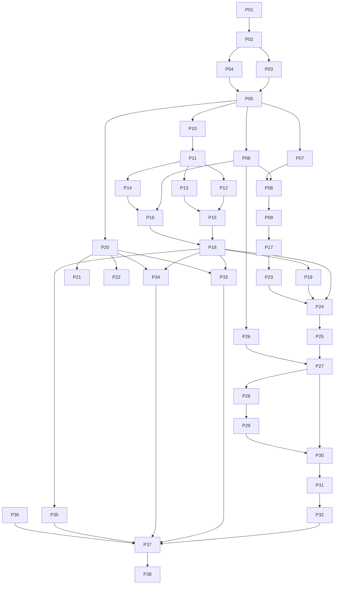

# Homebridge Rust — Implementation Plan

> **For agentic workers:** Use `executing-plans` for inline execution of the selected ticket. Steps use checkbox syntax for tracking. Le propriétaire demande **un ticket par session**, modèle choisi par lui, avec mémoire versionnée et PR. Ne pas déléguer ni enchaîner les tickets automatiquement. Lire `AGENTS.md` et `docs/project-state.md` au début.

**Goal:** Remplacer progressivement l'installation du QNAP TS-251+ par un pont Rust administrable sur le Web, avec volets io/RTS, garage, chauffage et actions existantes conservés.

**Architecture:** Un cœur Rust et des connecteurs compilés, une UI statique, un transport HomeKit validé au début. Le child bridge Homebridge reste actif pour les fonctions non encore remplacées. Le profil final sans Node.js est conditionné à la couverture de tout l'inventaire.

**Tech Stack:** Rust stable/2024, Tokio, Axum, serde, reqwest/Rustls, rusqlite, Svelte/TypeScript/Vite, Docker/Compose, QNAP QDK. HAP Rust après preuve, HAP-NodeJS en repli explicite.

**Spec:** [Architecture](../../architecture.md), [contrats](../../contracts.md), [guide Luna](../../execution-luna.md), [inventaire](../../inventory-template.md).

## Global Constraints

- Matériel prioritaire : QNAP TS-251+, Intel Celeron J1900, 2 Go ; construire hors du NAS, cible x86_64 générique.
- Box cible : TaHoma V2 ; io-homecontrol **et** RTS obligatoires.
- Inventaire visuel initial : 11 coverings, 2 thermostats, 1 garage, 9 Switch, soit 23 éléments à qualifier.
- Versions observées : Homebridge 2.4.0, UI 5.29.0, Node 24.21.0, homebridge-tahoma 2.2.64.
- Aucun secret, identifiant réel de passerelle, fichier de persistance ou inventaire nominatif dans le dépôt public.
- `observe` et `legacy` interdisent les écritures et la publication HomeKit depuis Rust.
- Une commande physique incertaine n'est jamais rejouée automatiquement.
- Un état estimé n'est jamais présenté comme mesuré ; aucune fermeture de garage inventée.
- Les contrats de `docs/contracts.md`, y compris les tailles de files et délais, s'appliquent à tous les tickets.
- Conserver tout usage existant via un chemin connu jusqu'à sa validation native ; ne pas confondre maintien legacy et remplacement terminé.
- Livraison Docker **et** `.qpkg` QNAP requises ; pas de compilation ni npm sur le NAS en profil natif.
- Tests automatiques sur données fictives ; les essais physiques constituent une phase distincte avec le propriétaire.
- Préfixer les commandes shell par `rtk` sur le poste courant, conformément au fichier RTK de l'environnement ; la CI utilise les outils natifs.
- Une session traite uniquement le ticket choisi et laisse son état dans `docs/project-state.md` et son rapport dans `docs/sessions/PXX.md`.

## Review Focus

1. POST TaHoma accepté mais réponse perdue : résultat `Unknown`, un seul envoi, aucun replay au reboot — P15/P18.
2. Télécommande RTS utilisée hors du logiciel : ne pas maintenir une position « confirmée » fictive — P13/P24.
3. Box usurpée, mauvaise CA ou redirection avec token : connexion refusée, aucun secret transmis ailleurs — P11.
4. Disque plein, archive hostile ou rollback de schéma : préserver données et identités avant toute bascule — P06/P26/P32.
5. Binaire incompatible avec le J1900, service QPKG dupliqué ou arrêté brutalement : refus clair ou arrêt propre, pas de perte d'état — P28/P29.

## 1. Exécution et taille des tâches

Une tâche ci-dessous est une unité de revue, généralement de 0,5 à 1,5 jour. Si elle dépasse une journée d'agent sans résultat vérifiable, la découper en sous-tâches de 1 à 3 heures conservant le même contrat. Une preuve HAP ou matérielle ne se conclut pas sur le seul résultat d'un agent.

Pour chaque ticket de code : lire les fichiers et tous les appelants → écrire le test ciblé → constater son échec pour la raison attendue → implémenter le minimum → exécuter la vérification indiquée → mettre à jour documentation/fixtures touchées → commit limité au ticket → revue. Une tâche de documentation ne nécessite pas de test artificiel.

Commandes indiquées avec `cargo`/`npm` ci-dessous : les exécuter via `rtk cargo ...` ou `rtk proxy npm ...` sur ce poste. Les scripts shell nouveaux ont une vérification avec `sh -n` et un scénario de service simulé ; les scripts de production ne sont jamais testés en lançant des moteurs réels.

Les packages workspace s'appellent exactement `bridge-core`, `integration-tahoma`, `transport-homekit`, `bridge-server`. `cargo test -p PACKAGE --test NAME` désigne le fichier `crates/PACKAGE/tests/NAME.rs`. Les scripts npm sont figés au P17 : `check`, `test`, `build`, `test:e2e`.

## 2. Dépendances et jalons

Les dépendances écrites dans chaque ticket priment sur le schéma simplifié. P21 **ou** P22 est activé après décision P04 ; un seul backend est nécessaire pour M3. P36 ne produit du code que si d'autres usages sont découverts. P35 n'est pas facultatif : les neuf Switch doivent être couverts même si leur implémentation provisoire reste legacy.

| Jalon | Tickets nécessaires | Sortie autorisée |
|---|---|---|
| M0 — décisions | P01–P05 | Contrats et décision HAP ; aucune migration |
| M1 — socle | P06–P09, P17 | UI/API sur simulateur, aucun appareil physique |
| M2 — Somfy | P10–P16, P18–P19 | Observation locale puis commandes de test sur simulateur |
| M3 — produit | P20 + P21 ou P22, P23–P26 | Parcours complet et pont de test |
| M4 — distribution | P27–P30 | Docker et QPKG testables, pas de bascule automatique |
| M5 — pilote | P31–P35, P37 | Validation réelle par famille, stabilité 72 h |
| M6 — retrait legacy | P36/P38 | Zéro dépendance legacy prouvée avant retrait de Node |

## 3. Tickets

### P01 — Dépôt public et dossier de conception

**Dépendances :** aucune. **Livrable :** `magic5644/homebridge-rust`, public conformément au choix du propriétaire, avec ce dossier uniquement.

**État : réalisé le 17 octobre 2026 pendant la préparation du dossier.** [Dépôt vérifié](https://github.com/magic5644/homebridge-rust). Pour l'état des tickets de développement, consulter [la mémoire courante](../../project-state.md).

**Fichiers :** `README.md`, `.gitignore`, `docs/**`. **Interfaces :** aucune API produit.

- [x] Vérifier le compte actif avec `gh api user --jq .login` et l'absence de dépôt homonyme ; ne jamais écraser un dépôt existant.
- [x] Vérifier les liens relatifs et rechercher les secrets/identifiants réels dans tous les fichiers publiables ; exclure `.graph-it`, données locales et métadonnées privées.
- [x] Initialiser `main`, créer le dépôt public, publier un commit `docs: plan Rust home automation bridge` et vérifier propriétaire, visibilité et commit distant.
- [x] Garder un statut « conception » dans le README ; aucune application fictivement annoncée installable.

**Clôture :** URL publique consultable, fichiers attendus présents, aucun code de production, aucune donnée privée publiée.

### P02 — Workspace compilable et socle de validation

**Dépendances :** P01 ; le lancement explicite de P02 avec le prompt de session autorise son socle minimal dans l'architecture proposée. **Fichiers :** `Cargo.toml`, `Cargo.lock`, `rust-toolchain.toml`, `crates/*/Cargo.toml`, `crates/*/src/lib.rs`, `crates/bridge-server/src/main.rs`, `crates/bridge-server/tests/cli_version.rs`, `docs/dependencies.md`, `scripts/check.sh`, `.github/workflows/check.yml`, `docs/sessions/P02.md` et mémoire courante.

**Produit :** quatre packages définis plus haut ; `bridge-server --version` et `bridge-server check --config PATH`.

- [ ] Figer versions Rust et dépendances après consultation Context7 des bibliothèques concernées ; documenter licences et versions sans prétendre qu'une famille vaut la version exacte.
- [ ] Créer les quatre packages avec le minimum de dépendances ; ne pas ajouter de framework de plugins.
- [ ] Ajouter `cli_version` : sortie contient version du package, code 0 ; config absente → erreur lisible, code non nul, aucun fichier écrasé.
- [ ] Créer `scripts/check.sh` comme point d'entrée de `cargo fmt --all -- --check`, `cargo clippy --workspace --all-targets --locked -- -D warnings`, `cargo test --workspace --locked`, `cargo build -p bridge-server --release --locked` ; le script s'arrête au premier échec. Vérifier `sh -n`, son échec sur un contrôle simulé en erreur et l'exécution réelle de ces commandes.
- [ ] Faire exécuter ce script en CI selon la mémoire GitHub Actions : job stable `Rust checks`, PR/push main, permissions minimales, actions épinglées, timeout et données fictives. Choisir la licence du code et conserver les notices des composants repris.
- [ ] Pousser une branche et créer une PR, vérifier la CI du dernier commit ; consigner commandes, résultats et limites dans `docs/sessions/P02.md` et `docs/project-state.md`. Aucune fusion ni release automatique.

**Clôture :** build reproductible minimal, CI verte, aucun appel réseau domestique au démarrage des tests.

### P03 — Inventaire exploitable, baseline et fixtures

**Dépendances :** P02 ; lecture seule de l'installation par une session autorisée. **Fichiers :** `docs/compatibility.md`, `docs/performance-baseline.md`, `fixtures/tahoma/*.json`, `tests/fixtures_manifest.json`. Données réelles : `private/` exclu de Git.

**Produit :** liste anonymisée des 23 éléments visibles, distinction appareil physique/action, fonctionnalités utilisées et chemin de secours.

- [ ] Relever QTS, Container Station, topologie et ports, versions et configuration utile du plugin ; ne jamais copier secrets ou `persist/` dans les fixtures.
- [ ] Lire le setup TaHoma avec un token fourni localement ; relever `controllableName`, commandes, états et modèle pour chaque profil io/RTS, garage et chauffage.
- [ ] Classer les neuf Switch ; relever leurs effets, et la façon dont ils sont utilisés dans Maison. État affiché dans l'UI ≠ preuve de mesure physique.
- [ ] Mesurer les processus requis pendant 30 min après échauffement, sans modifier les services ; distinguer mémoire hôte, RSS/PSS et cgroup.
- [ ] Produire les fixtures minimales du contrat avec des données fictives, puis un manifeste validant JSON, fichiers et absence de vrais identifiants.

**Vérification :** `python3 -m json.tool FILE` pour chaque fixture ; revue du tableau : chaque usage a une route actuelle et une cible. Les profils manquants sont un prérequis explicite du ticket concerné, pas un support déclaré.

### P04 — Décision HomeKit Rust, budget maximal trois jours

**Dépendances :** P02. **Fichiers :** `experiments/hap-proof/`, `docs/decisions/0001-homekit-backend.md`, `docs/hardware/hap-proof.md` ; aucune clé d'appairage versionnée.

**Consomme :** candidat `ewilken/hap-rs` épinglé et HAP-NodeJS de référence. **Produit :** décision `native-approved`, `sidecar-required` ou `stop-and-review` et preuve reproductible.

- [ ] Audit ciblé : compatibilité toolchain, dépendances, persistance, permissions, qualité des tests, besoin de maintenance ; compiler sous Linux x86_64 générique.
- [ ] Exposer un interrupteur et un covering fictifs ; vérifier découverte, pairing, lectures, écritures et notifications depuis un contrôleur de test.
- [ ] Tester redémarrage, ajout/retrait d'accessoire, suppression de contrôleur, données malformées et arrêt propre ; obtenir une preuve sur Apple Maison avec un pont de test.
- [ ] Mesurer le prototype et noter tous les correctifs nécessaires. Aucune implémentation cryptographique maison et aucun contournement TLS/auth.
- [ ] Choisir P21 ou P22 ; si un travail substantiel sur HAP est requis, le chiffrer séparément. À trois jours, décider avec les preuves disponibles.

**Clôture :** décision revue humainement pour HAP et sécurité ; un exemple compilé seul n'autorise pas `native-approved`.

### P05 — Types et invariants partagés

**Dépendances :** P03, P04. **Fichiers :** `crates/bridge-core/src/{model,error,event,config}.rs`, `crates/bridge-core/tests/model_contract.rs`, exports `lib.rs` ; mise à jour du contrat si nécessaire.

**Consomme/produit :** tous les types des sections 1–6 des contrats, noms et sérialisation exacts.

- [ ] Tests `position_bounds` : 0 et 100 acceptés, 101 rejeté ; `unsupported_command` : commande hors capacité → `validation_error`.
- [ ] Tests `quality_is_honest` : inconnu sans valeur ; estimation jamais convertie en mesure ; `ownership_blocks_writes` pour `legacy` et `observe`.
- [ ] Implémenter les types, erreurs et validations ; pas de logique HTTP ni de dépendance TaHoma dans le cœur.
- [ ] Vérifier `cargo test -p bridge-core --test model_contract` puis le workspace ; sauvegarder les exemples JSON partagés.

**Clôture :** consommateurs peuvent travailler sans renommer les interfaces à leur convenance.

### P06 — SQLite, identités et atomicité

**Dépendances :** P05. **Fichiers :** `bridge-core/src/store.rs`, `bridge-core/src/migrations/001.sql`, `bridge-core/tests/store_contract.rs`, `bridge-core/tests/store_failures.rs` sous `crates/`.

**Produit :** API `Store` du contrat, worker dédié et verrou du répertoire.

- [ ] `identity_survives_rename_restart` : même UUID et AID/IID après rename, réordre, retrait temporaire et réouverture ; aucun recyclage implicite.
- [ ] `revision_and_state_commit_together`, `second_writer_refused`, `idempotency_persists` et `interrupted_command_becomes_unknown` avec base temporaire.
- [ ] `disk_full_preserves_previous_state` : simuler l'échec d'écriture ; aucune révision ni réussite publiée ; ancienne base relisible.
- [ ] Implémenter tables/contraintes et transactions, file de 64, API async sans blocage SQLite sur Tokio.
- [ ] Vérifier `cargo test -p bridge-core --test store_contract --test store_failures` ; échec d'une migration → ancienne base préservée/restaurable.

### P07 — Configuration et secrets locaux

**Dépendances :** P05. **Fichiers :** `bridge-core/src/config.rs`, `bridge-core/src/secrets.rs`, `bridge-core/tests/config_contract.rs`, `config.example.json`.

**Produit :** `load_config(path: &Path) -> Result<AppConfig, BridgeError>` ; `save_config_atomic(path: &Path, config: &AppConfig) -> Result<(), BridgeError>` ; `AppConfig` contient listen, data_dir, TahomaConfig et HomeKitConfig.

- [ ] Tests : config invalide refusée sans écriture, token jamais sérialisé, permissions 0600 et répertoire 0700, fichier précédent conservé après échec de remplacement.
- [ ] Définir schema_version=1, écoute par défaut `127.0.0.1:8582`, HAP 51827 ; valider les conflits connus sans supposer que les ports sont libres.
- [ ] Charger les secrets depuis fichiers, pas depuis des URLs ou arguments de commande ; exemples sans valeur réelle.
- [ ] Vérifier `cargo test -p bridge-core --test config_contract` ; `bridge-server check` ne se connecte pas aux appareils et ne les modifie pas.

### P08 — Authentification et enveloppe API

**Dépendances :** P06, P07. **Fichiers :** `bridge-server/src/api/{mod,auth,error}.rs`, `bridge-server/src/bootstrap.rs`, `bridge-server/tests/auth_contract.rs`, `docs/api/openapi.yaml`.

**Produit :** routes setup/auth/health des contrats ; session en base, CSRF, erreurs normalisées et limites.

- [ ] Tests : setup à code expiré/incorrect refusé ; création une seule fois ; mot de passe haché ; session invalidée après logout.
- [ ] Tests : écriture sans session → 401, sans CSRF ou Origin valide → 403 ; payload >256 Kio → 413 ; auth limitée sans rendre les erreurs révélatrices.
- [ ] Implémenter Argon2id hors des workers async, sessions aléatoires ; aucune valeur sensible dans logs ; code de setup valable 10 min.
- [ ] Décrire les routes du contrat dans OpenAPI, avec schémas de requête/réponse et exemples fictifs.
- [ ] Vérifier `cargo test -p bridge-server --test auth_contract` et test de connexion via proxy HTTPS de développement.

### P09 — Serveur simulé et API de lecture

**Dépendances :** P08, P03. **Fichiers :** `bridge-server/src/simulator.rs`, `bridge-server/src/api/devices.rs`, `bridge-server/tests/read_api.rs`, `fixtures/api/*.json`.

**Produit :** `GET devices/system/integrations` fonctionnels sur fixtures, lancement explicite `serve --simulate` ; jamais actif par défaut.

- [ ] Tests : liste et révision conformes au contrat, identifiants source/jetons absents ; appareil inconnu reste visible sans commandes.
- [ ] Charger les fixtures dans une base temporaire et fournir le même registre que la future intégration ; pas de serveur parallèle dédié aux tests UI.
- [ ] Vérifier `cargo test -p bridge-server --test read_api` ; fixture API consommable par le frontend.

### P10 — Découverte TaHoma et identité réseau

**Dépendances :** P05. **Fichiers :** `integration-tahoma/src/discovery.rs`, `integration-tahoma/tests/discovery_contract.rs`.

**Produit :** fonction `discover(Duration)` du contrat, sans lecture d'équipement et sans activation du mode développeur.

- [ ] Tests : TXT attendu accepté ; nom correspondant mais PIN TXT différent rejeté ; doublon multi-interface dédupliqué ; délai sans résultat → liste vide.
- [ ] Naviguer uniquement le service développeur documenté ; permettre une adresse manuelle conservant le nom DNS pour TLS.
- [ ] Vérifier `cargo test -p integration-tahoma --test discovery_contract` avec annonces simulées ; test mDNS réel optionnel séparé.

### P11 — Client HTTP TaHoma et validation TLS

**Dépendances :** P10, P07, P03. **Fichiers :** `integration-tahoma/src/{client,dto}.rs`, `integration-tahoma/tests/{http_contract,tls_contract}.rs`, CA fabricant avec provenance et empreinte documentées.

**Produit :** `TahomaClient` et DTO du contrat ; client réutilisé, timeout 5 s, setup limité à 4 Mio.

- [ ] Tests : bon Bearer et CA → setup lu ; token invalide → erreur dédiée ; mauvaise CA/nom → échec ; redirection → aucun second hôte contacté.
- [ ] Tests : variable de proxy système ignorée pour la box ; réponse trop grande/tronquée → erreur, pas de boucle ; champs supplémentaires tolérés.
- [ ] Implémenter uniquement routes nécessaires à setup, événements et exécution ; utiliser les verbes officiels et encoder les segments d'URL.
- [ ] Vérifier `cargo test -p integration-tahoma --test http_contract --test tls_contract` ; aucun token dans les captures de logs du test.

### P12 — Mapping des volets/stores io

**Dépendances :** P11. **Fichiers :** `integration-tahoma/src/mapping/{mod,covering_io}.rs`, `integration-tahoma/tests/covering_io.rs`.

**Produit :** `map_device` et `encode_command` pour les profils io inventoriés ; conventions du contrat.

- [ ] Tests par profil réel anonymisé : fermé=0, ouvert=100, position 80, inverse si le profil fabricant l'impose ; aucun renversement global par supposition.
- [ ] Vérifier qu'ouvrir/fermer/stop/position sont sélectionnés dans les commandes déclarées et que l'inclinaison n'est proposée que si réellement disponible.
- [ ] Représenter les erreurs radio et états absents sans remplacer une mesure par la dernière consigne.
- [ ] Vérifier `cargo test -p integration-tahoma --test covering_io` et les fixtures de projection communes.

### P13 — RTS et estimation explicite

**Dépendances :** P11, P12 pour l'intégration au dispatcher partagé. **Fichiers :** `integration-tahoma/src/mapping/covering_rts.rs`, `bridge-core/src/estimation.rs`, tests `covering_rts.rs` et `estimation_contract.rs` dans leurs packages.

**Produit :** actions RTS disponibles ; estimation uniquement après calibration par appareil.

- [ ] `rts_without_feedback_is_unknown` : aucun état fabricant → position inconnue, pas 0/100 par défaut ; les commandes restent celles réellement supportées.
- [ ] Sans calibration : refuser `SetPosition` si le matériel ne sait pas la réaliser ; conserver ouvrir/fermer/stop si déclarés.
- [ ] Si la position intermédiaire est un usage existant, implémenter des durées montée/descente distinctes, horloge monotone, bornes et invalidation après reboot/rupture de suivi ; test avec temps simulé, aucun moteur.
- [ ] `external_remote_invalidates_estimate` : événement ou incertitude de contrôle retire la confirmation ; l'UI explique la limite d'une télécommande non observable.
- [ ] Vérifier `cargo test -p integration-tahoma --test covering_rts` et `cargo test -p bridge-core --test estimation_contract`.

**Clôture :** pas de déplacement automatique de calibration ; garder legacy si l'usage intermédiaire actuel ne peut pas être reproduit honnêtement.

### P14 — Flux d'événements et réconciliation

**Dépendances :** P11, P06. **Fichiers :** `integration-tahoma/src/events.rs`, `integration-tahoma/tests/events_contract.rs`.

**Produit :** `run_events(client: TahomaClient, store: Store, cancel: CancellationToken)` async, retour `Result<(), BridgeError>` ; disponibilité et instantanés cohérents, publication via le Store.

- [ ] Tests avec horloge simulée : une récupération/seconde maximum ; listener invalide/reboot → réinscription ; lectures en panne → backoff 1..30 s avec dispersion.
- [ ] Tester trou entre setup et inscription : réconciliation récupère l'état ; appareil ajouté/supprimé/inconnu ne fait pas planter le flux.
- [ ] Flux sain sans changement → état confirmé conservé ; flux défaillant >30 s → données périmées ; après reprise → refresh avant confirmation.
- [ ] Vérifier `cargo test -p integration-tahoma --test events_contract` ; annulation libère le listener si accessible, sans bloquer l'arrêt plus de 10 s.

### P15 — Exécution fabricant et résultat incertain

**Dépendances :** P12, P13, P11. **Fichiers :** `integration-tahoma/src/commands.rs`, `integration-tahoma/tests/command_transport.rs`.

**Produit :** `execute` et `execution` du contrat ; aucune relance automatique des POST.

- [ ] Test : le simulateur accepte le POST puis ferme la connexion → un seul envoi et résultat incertain ; jamais un nouvel essai implicite reqwest.
- [ ] Tester refus fabricant, exécution échouée, réponse acceptée sans état physique et événement tardif ; le 200 HTTP seul ne produit pas `Succeeded`.
- [ ] Mapper uniquement les résultats documentés/observés ; suivi borné à 120 s, expiration → `Unknown` si issue non prouvée.
- [ ] Vérifier `cargo test -p integration-tahoma --test command_transport` ; paramètres sensibles expurgés.

### P16 — Orchestration et santé du daemon

**Dépendances :** P06–P09, P14. **Fichiers :** `bridge-server/src/{runtime,health,main}.rs`, `bridge-server/tests/lifecycle.rs`.

**Produit :** assemblage Store/connecteur/API, annulation partagée et état de santé.

- [ ] Tests : box absente au démarrage → API utilisable, ready=200 si stockage prêt et intégration dégradée ; base inutilisable → ready=503.
- [ ] SIGTERM ferme admission, flux et worker en ≤10 s, y compris avec SSE ouvert et requête fabricant bloquée.
- [ ] Démarrer un seul superviseur par intégration ; erreurs permanentes affichées sans redémarrage agressif.
- [ ] Vérifier `cargo test -p bridge-server --test lifecycle` et que les tâches créées sont toutes suivies et annulées.

### P17 — Interface statique et contrat navigateur

**Dépendances :** P09. **Fichiers :** `web/package.json`, lockfile, configuration Svelte/Vite/TypeScript, `web/src/{App.svelte,lib/api.ts,lib/types.ts}`, `bridge-server/src/assets.rs`, tests frontend de lecture.

**Produit :** build statique embarqué ; scripts npm nommés dans la section 1.

- [ ] Consommer les exemples de `fixtures/api` ; tests de lecture d'instantané/erreur, affichage inconnu et absence de données sensibles.
- [ ] Implémenter un client de même origine, cookies de session et transmission du CSRF ; pas de token dans localStorage.
- [ ] Embarquer les assets compilés, servir les types MIME corrects et ne pas transformer une route `/api` inconnue en `index.html`.
- [ ] Vérifier `npm ci`, `npm run check`, `npm test`, `npm run build` dans `web/`, puis test de service des assets par le binaire ; aucun Node pour servir la production.

### P18 — Routeur unique des commandes et idempotence

**Dépendances :** P15, P16. **Fichiers :** `bridge-core/src/command.rs`, `bridge-server/src/command_router.rs`, `bridge-server/src/api/commands.rs`, `bridge-server/tests/command_router.rs`.

**Produit :** `CommandRouter::submit` et routes de commandes du contrat ; `CommandEnvelope` pour HomeKit.

- [ ] Tests : native accepte ; observe/legacy refuse sans appel fabricant ; capacité/valeur invalide refuse ; appareil indisponible → 503.
- [ ] Double request_id/contenu identique → même command_id et un envoi ; même ID/contenu différent →409 ; comportement conservé après reboot.
- [ ] Queue=32 et une commande ordinaire active/appareil ; saturation →429, pas de tâche infinie ; attente >5 s → annulation avant transmission ; propriété revérifiée à cet instant.
- [ ] `stop_interrupts_pending_position` et `stop_allowed_while_moving` : stop prioritaire, position non envoyée annulée ; une commande déjà envoyée n'est pas faussement déclarée annulée physiquement.
- [ ] Test crash après admission puis après envoi : opérations incertaines en `Unknown`, aucun replay automatique ; vérifier `cargo test -p bridge-server --test command_router`.

### P19 — SSE borné et clients lents

**Dépendances :** P18. **Fichiers :** `bridge-server/src/api/events.rs`, `bridge-server/tests/sse_contract.rs`, `web/src/lib/events.ts` et tests associés.

**Produit :** événements du contrat, heartbeat 15 s, limite 16 clients.

- [ ] Tests : client déconnecté puis reconnecté récupère un instantané ; retard de >256 événements → resync ; 17e client →429.
- [ ] Notifications seulement après commit Store ; cookies/session obligatoires ; fermeture sur logout/expiration ou arrêt du serveur.
- [ ] Vérifier `cargo test -p bridge-server --test sse_contract`, puis tests frontend avec déconnexion/reconnexion simulées ; aucune accumulation illimitée dans le navigateur.

### P20 — Projection HomeKit indépendante du backend

**Dépendances :** P05, P06, P12, P13. **Fichiers :** `transport-homekit/src/projection.rs`, `transport-homekit/tests/projection_contract.rs`, `fixtures/homekit/*.json`.

**Produit :** projection stable appareils/capacités → services/caractéristiques, consommateurs des UUID et AID/IID persistés.

- [ ] Tests : seuls les appareils native publiés ; rename/restart/reorder gardent les identifiants ; 150e appareil derrière un pont → refus explicite ou groupe préalablement planifié.
- [ ] Position inconnue → erreur de communication sur lecture plutôt que valeur inventée ; read/write permissions respectées ; read-only non modifiable.
- [ ] Vérifier mappings fermé=0/ouvert=100 avec fixtures identiques aux couches API/Somfy, et resync après événement perdu.
- [ ] Vérifier `cargo test -p transport-homekit --test projection_contract` ; aucun appel moteur par cette projection seule.

### P21 — Backend HAP Rust, si approuvé

**Dépendances :** P04=`native-approved`, P20, P18, P19. **Fichiers :** `transport-homekit/src/{lib,native}.rs`, tests `native_contract.rs`, adaptations ciblées au fork HAP si nécessaires.

**Produit :** `transport_homekit::run` du contrat, raccordé au même routeur que le Web.

- [ ] Reprendre les preuves P04 sous forme de tests de contrat, y compris persistance, révocation, notification et données hostiles ; utiliser l'API de la pile épinglée.
- [ ] Toute écriture HomeKit devient un CommandRequest ; réponse rapide d'admission, résultat physique suivi séparément ; lectures depuis l'état mis en cache.
- [ ] Vérifier `cargo test -p transport-homekit --test native_contract`, le workspace puis Apple Maison sur pont fictif.

**Clôture :** version et correctifs HAP traçables ; aucune dépendance Node en profil natif.

### P22 — Repli HAP-NodeJS, seulement si nécessaire

**Dépendances :** P04=`sidecar-required`, P20, P18, P19. **Fichiers :** `compat/hap-node/{package.json,package-lock.json,src/index.ts}`, `transport-homekit/src/sidecar.rs`, tests `sidecar_contract.rs`, profil Compose correspondant.

**Produit :** même interface `run`, protocole interne JSON-lines version 1 sur Unix socket privé ; aucun port interne public.

- [ ] Figer Node/HAP-NodeJS compatibles depuis la documentation courante ; aucun installateur ou chargement de plugins npm au runtime.
- [ ] Messages bornés à 256 Kio : `snapshot`, `state_update`, `command_request`, `command_reply`, `health` ; request_id identique jusqu'au routeur ; socket et persistance privés.
- [ ] Tester crash du sidecar, reconnexion et resync ; commandes en vol inconnues sans replay ; superviser avec backoff borné et statut visible.
- [ ] Vérifier les mêmes projections que P21, tests Node et `cargo test -p transport-homekit --test sidecar_contract` ; mesurer les deux processus ensemble.

**Clôture :** profil nommé « hybride » ; pas de prétention de compatibilité des plugins par cette couche.

### P23 — UI de connexion et de configuration TaHoma

**Dépendances :** P17, P11, P08. **Fichiers :** `web/src/pages/{Setup,Login,Integrations}.svelte`, `web/tests/setup.spec.ts`.

**Produit :** parcours premier compte → connexion → test TaHoma → lecture d'inventaire en observation.

- [ ] E2E : mauvais token/CA affiche une erreur utile, aucun token réaffiché ; succès affiche les appareils, sans commande ni publication automatique.
- [ ] Champs accessibles, langue française, collage du token possible ; prévenir l'utilisateur avant de quitter un formulaire non enregistré.
- [ ] Vérifier `npm run check`, tests ciblés, `npm run test:e2e -- setup.spec.ts` sur simulateur HTTPS ; aucun équipement réel.

### P24 — UI appareils et commandes

**Dépendances :** P23, P18, P19. **Fichiers :** `web/src/pages/Devices.svelte`, `web/src/components/{DeviceCard,CommandStatus}.svelte`, `web/tests/devices.spec.ts`.

**Produit :** contrôles déterminés par les capacités, propriété et disponibilité ; état d'exécution distinct de l'état physique.

- [ ] E2E : native peut commander, observe/legacy ne le peut pas ; états inconnus/périmés/estimés identifiables par texte, pas seulement couleur.
- [ ] Double clic utilise le même request_id pendant l'admission ; nouvelle action volontaire obtient un nouvel ID ; erreur réseau n'entraîne pas de réémission automatique.
- [ ] Afficher calibration RTS et ses limites seulement pour les profils concernés ; aucune calibration physique automatique.
- [ ] Vérifier `npm run test:e2e -- devices.spec.ts`, navigation clavier et vue mobile ; tests du composant état pour absence de feedback.

### P25 — UI HomeKit, paramètres et diagnostics

**Dépendances :** P24, P20, P21 ou P22. **Fichiers :** pages `HomeKit.svelte`, `Settings.svelte`, `Diagnostics.svelte`, `web/tests/administration.spec.ts`, routes correspondantes `bridge-server/src/api/`.

**Produit :** backend actif, appairage restreint, métriques du service, logs expurgés et liens d'administration legacy.

- [ ] Tests : QR/PIN absent sans session, no-store, jamais dans logs ; 500 lignes maximum et troncature des messages géants.
- [ ] Afficher RSS du produit et la limite de cette métrique ; ne pas présenter la RAM libre du NAS comme mémoire consommée par le produit.
- [ ] Pas de bouton de mise à jour improvisant un shell ; fournir instructions adaptées au mode d'installation et lien de sauvegarde.
- [ ] Vérifier les routes par tests HTTP et `npm run test:e2e -- administration.spec.ts`.

### P26 — Sauvegarde et restauration sûres

**Dépendances :** P06, P07, P08. **Fichiers :** `bridge-core/src/backup.rs`, `bridge-server/src/cli/backup.rs`, `bridge-server/src/api/backups.rs`, `bridge-core/tests/backup_contract.rs`, `docs/operations/backup.md`.

**Produit :** manifeste versionné, sauvegarde cohérente SQLite et validation Web ; application par CLI locale service arrêté.

- [ ] Tests : restaurer une sauvegarde complète conserve identités et appairages propres au nouveau produit ; sauvegarde Web exclut sessions/secrets et liste les éléments à ressaisir.
- [ ] Rejeter path traversal, liens symboliques, archive-bombe, checksum faux, >1 000 entrées, >50 Mio compressés/>200 Mio extraits et schéma futur.
- [ ] Valider dans répertoire temporaire, sauvegarder l'état précédent et remplacer atomiquement ; injection d'échec → ancien état encore utilisable.
- [ ] Vérifier `cargo test -p bridge-core --test backup_contract` et cycle CLI sur répertoire temporaire ; jamais sur l'installation Homebridge actuelle.

### P27 — Image Docker et Compose pour QNAP

**Dépendances :** P25, P26, backend retenu opérationnel. **Fichiers :** `packaging/docker/Dockerfile`, `compose.yaml`, `compose.hybrid.yaml` si requis, `.dockerignore`, `docs/install/docker-qnap.md`, `tests/packaging/docker-smoke.sh`.

**Produit :** image sans compilation runtime, volume `/data`, user configurable, réseau host Linux et healthcheck interne.

- [ ] Smoke : read-only root, cap-drop ALL, aucun privileged/socket Docker ; persistance après recréation, SIGTERM ≤10 s, box hors ligne ne déclenche pas d'échec live.
- [ ] `docker compose config` valide ; pas de `ports:` avec host ; écoute UI explicite et ports HAP libres.
- [ ] Construire et exécuter amd64 ; exécuter aussi arm64 sur runner natif ou émulation identifiée comme telle ; ne pas appeler cela un test NAS arm64.
- [ ] Décrire installation Container Station compatible avec la version QTS relevée au P03, permissions de dossier et reverse proxy HTTPS.
- [ ] Vérifier `sh -n tests/packaging/docker-smoke.sh` puis smoke sur environnement de test ; pas de déploiement automatique sur le NAS de production.

### P28 — Archive native compatible J1900

**Dépendances :** P27. **Fichiers :** `packaging/native/build.sh`, `packaging/native/README.md`, `tests/packaging/native-smoke.sh`, configurations de cibles nécessaires.

**Produit :** archive `linux-x86_64` générique, UI embarquée et sommes SHA-256 ; archive arm64 secondaire si CI disponible.

- [ ] Vérifier libc/noyau/crypto/résolution multicast ; comparer musl et glibc sur la cible, sélectionner une variante documentée qui fonctionne sur QTS.
- [ ] Tests : aucun `target-cpu=native`, `--version`, `check`, `serve --simulate`, stockage persistant et arrêt propre sans Node/npm/Rust installés sur l'hôte de test.
- [ ] Smoke réel sur J1900 avant annonce compatible ; erreur claire si instructions ou noyau incompatibles, jamais un binaire seulement testé sur le Mac du développeur.
- [ ] Vérifier syntaxe shell, artefact, checksum et protocole d'arrêt ; installer seulement dans un répertoire isolé pour l'essai.

### P29 — Paquet QNAP `.qpkg`

**Dépendances :** P28, version QTS P03. **Fichiers :** `packaging/qnap/{qpkg.cfg,package_routines,shared/homebridge-rust.sh}`, script de build, `tests/packaging/qpkg_service.sh`, `docs/install/qpkg.md`.

**Produit :** paquet QDK x86_64 avec start/stop/restart/status, données hors du répertoire remplacé en mise à jour.

- [ ] Lire la documentation QDK courante, figer sa version ; ne pas utiliser les chemins de volumes du développeur dans le paquet.
- [ ] Test simulé du service : start deux fois → un processus ; PID réutilisé → ne pas tuer un autre programme ; stop attend et gère un daemon bloqué sans détruire les données.
- [ ] Tester installation, upgrade, désactivation, reboot et désinstallation sur QTS de test ou avec le propriétaire ; données conservées et règle de suppression explicite.
- [ ] Installation privilégiée minimale puis daemon sous compte de service ; droits et propriétaire `/data` vérifiés.
- [ ] Vérifier `sh -n` et `sh tests/packaging/qpkg_service.sh`, métadonnées QDK et artefact réel. Documenter signature/approbation App Center ; ne pas désactiver automatiquement les protections du NAS.

**Clôture :** installation manuelle simple démontrée sur TS-251+ ; aucune promesse d'inscription automatique au catalogue QNAP.

### P30 — CI de publication et traçabilité

**Dépendances :** P27–P29. **Fichiers :** `.github/workflows/{check,release}.yml`, `docs/release.md`, `CHANGELOG.md`.

**Produit :** tests PR, builds Docker multiarch et archive/QPKG, notes, licences, checksums et nomenclature de composants.

- [ ] Les PR exécutent tests et builds sans publication ni secret disponible aux forks ; permissions GitHub minimales.
- [ ] Sur tag approuvé, publier version immuable et digest GHCR ; vérifier réellement l'accès anonyme à l'image, un dépôt public ne suffit pas à garantir un package GHCR public.
- [ ] Inclure dépendances et licences (Homebridge/HAP-NodeJS Apache-2.0, UI MIT au moment de la recherche) et les obligations des composants redistribués ; aucune réutilisation du logo comme marque officielle.
- [ ] Valider workflow sur version de test ; pas de release « stable » avant P37. Les credentials de signature restent hors dépôt.

### P31 — Mesures comparables et endurance simulée

**Dépendances :** P30, P03, backend retenu. **Fichiers :** `tests/performance/`, `docs/performance-results.md`, résultats anonymisés.

**Produit :** rapport reproductible avec versions, hardware et périmètre exact.

- [ ] Scénarios 50/100 appareils : repos, rafale d'états, 5 clients/1 000 lectures, client lent, reconnexions et taille maximale des files.
- [ ] Rapporter RSS/PSS, cgroup séparé, CPU, p95 API/admission, démarrage et pic mémoire ; inclure sidecar et legacy requis.
- [ ] Endurance 72 h : pas de crash, tâches/fichiers stables, plateau mémoire et dérive <10 % selon l'architecture.
- [ ] Comparer aux cibles : 64/128 Mio de RSS natif, gain domestique de 50 % proposé ; si échec, profiler le point mesuré et créer une correction ciblée.

**Clôture :** mesures brutes conservées localement, résumé public sans topologie ni noms ; aucune revendication de gain non mesuré.

### P32 — Migration observée et rollback vérifié

**Dépendances :** P31, P26, P03. **Fichiers :** `bridge-server/src/api/ownership.rs`, `docs/operations/{migration,rollback}.md`, `bridge-server/tests/ownership_migration.rs`, UI migration.

**Produit :** passage d'état protégé par expected_revision et checklist de bascule ; aucune modification distante automatique de Homebridge.

- [ ] Tester transition legacy→observe→native avec révision correcte ; conflit →409 ; revenir observe coupe admission et publication sans effacer identités.
- [ ] Après changement de propriété, réconcilier HomeKit et UI et annuler les commandes non envoyées ; une commande déjà transmise est rapportée incertaine si son issue n'est plus suivie. Tester le changement de propriété pendant l'attente en file.
- [ ] Vérifier sur simulateur le retour à une ancienne version avec sauvegarde compatible, et le refus de lire silencieusement un schéma futur.
- [ ] Répéter le rollback sur un pont de test ; documenter les limites de récupération des pièces/scènes/appairages Apple.

### P33 — Porte de garage Somfy, lot requis

**Dépendances :** P03, P18, P20, P24 ; contrôle humain avant test physique. **Fichiers :** `integration-tahoma/src/mapping/garage.rs`, tests `garage_contract.rs`, projection `transport-homekit/src/projection.rs`, composant UI, `docs/compatibility/garage.md`.

**Consomme :** modèle exact, liste des commandes et états/obstacle disponibles, nature io ou RTS, configuration cyclique du plugin actuel. **Produit :** mode de contrôle honnête et équivalent à l'usage validé.

- [ ] Sous-tâche qualification : tableau commande déclarée → effet, état → preuve physique ; observer sans actionner. Si seules des impulsions existent, ne pas coder des commandes ouvrir/fermer déterministes.
- [ ] Tests `unknown_is_not_closed`, `no_fake_obstruction`, `cyclic_is_not_open_close`, `no_replay_after_timeout` ; aucune inférence de fermeture d'après une durée.
- [ ] Cas A : états/sécurités suffisants → GarageDoorOpener, lectures et commandes validées. Cas B : boutons momentanés distincts seulement s'ils sont prouvés et acceptés ; affichage « état inconnu ». Cas C : conserver legacy et préciser capteur ou API manquant.
- [ ] Vérifier tests connecteur, cœur, projection et UI ; la simulation ne vaut pas validation de la sécurité mécanique.
- [ ] Avec le propriétaire, valider commande depuis Maison, télécommande, arrêt/obstacle selon procédure constructeur et perte réseau ; aucun essai d'obstacle improvisé.

**Clôture :** acceptation écrite du profil ; le ticket ne devient pas « natif terminé » si le garage reste legacy.

### P34 — Deux thermostats, lot requis

**Dépendances :** P03, P18, P20, P24. **Fichiers :** `integration-tahoma/src/mapping/heating.rs`, tests `heating_contract.rs`, projection et UI chauffage, `docs/compatibility/heating.md`.

**Produit :** fonctions effectivement utilisées sur les deux profils de chauffage, sans température fictive.

- [ ] Qualifier thermostat réel, radiateur à fil pilote ou mode seul ; relever consignes, modes, bornes, capteur éventuel et durées de dérogation.
- [ ] Tests : absence de capteur → température inconnue ; borne/quantum invalide rejeté ; mode non déclaré refusé ; changement depuis TaHoma répercuté.
- [ ] Si modes nécessaires hors `SetSetpoint`, étendre explicitement le contrat avec l'enum minimale des modes réellement observés et mettre à jour routeur, API, UI, HomeKit et fixtures dans le même lot.
- [ ] Vérifier tests du mapping, projection et E2E ; contrôler le résultat réel avec le propriétaire sans modifier les programmes de chauffage existants.

**Clôture :** deux appareils couverts ou limite documentée avec maintien legacy ; aucun faux 0 °C pour remplir un champ HomeKit obligatoire.

### P35 — Neuf Switch et scénarios, lot requis

**Dépendances :** P03, P18, P20, P24 ; ne pas supposer que les Switch sont physiques. **Fichiers :** `docs/compatibility/actions.md`, fixtures dédiées et fichiers de modèle/API/UI uniquement selon le profil retenu.

**Produit :** neuf lignes avec effet, dépendances, voie de commande, résultat et couverture.

- [ ] Qualifier chaque Switch : scénario TaHoma, groupe de commandes, équipement physique ou autre ; noter fermetures, chauffage et garage potentiellement inclus.
- [ ] Chercher une API locale de scénarios uniquement dans les sources officielles et sur le firmware présent ; ne pas coder des endpoints devinés ou un succès simulé.
- [ ] Si un scénario est un groupe statique entièrement connu, proposer un groupe local minimal réutilisant CommandRouter ; définir `ActionGroup`, résultat par action, échec partiel et limites, puis mettre à jour les contrats avant code. Une exécution n'est jamais déclarée atomique.
- [ ] Si un scénario dépend de logique/horaires fabricant ou d'une API non couverte, garder son Switch sur Homebridge ; ne pas recréer un moteur d'automatisation implicite.
- [ ] Tests : groupe partiellement refusé → rapport partiel, aucune compensation physique automatique ; retry réseau ne déclenche pas deux fois ; une action garage respecte P33.

**Clôture :** chaque usage fonctionne ; remplacement natif ou maintien legacy clairement séparés. P38 reste bloqué tant qu'un usage exige legacy.

### P36 — Autres usages et protocole d'ajout d'intégration

**Dépendances :** inventaire P03 et validation du propriétaire si usage nouveau. **Fichiers :** `docs/compatibility.md`, ticket par famille découverte.

**Produit :** couverture exhaustive, sans ajouter préventivement tous les protocoles domotiques.

- [ ] Vérifier si un autre plugin, une caméra, Matter, un capteur ou une automatisation est utilisé hors des 23 éléments visibles ; absence documentée = tâche sans code.
- [ ] Pour chaque besoin réel : capturer une fixture anonyme, fixer capacités/commandes/erreurs, écrire tests de contrat, implémenter le connecteur minimal, valider UI/HomeKit et matériel, définir rollback.
- [ ] Un ticket doit nommer ses fichiers, interfaces et tests avant affectation à Luna ; ne pas affecter « supporter Zigbee » sans coordinateur et appareils précis.

**Clôture :** aucune ligne d'inventaire sans propriétaire et chemin fonctionnel ; le périmètre peut rester à 23 si confirmé.

### P37 — Acceptation sur le QNAP et essai domestique

**Dépendances :** P32–P36, backend retenu, Docker et QPKG P27/P29 ; fenêtre convenue avec le propriétaire. **Fichiers :** `docs/acceptance.md`, rapport détaillé privé si nécessaire.

- [ ] Installer en observation sur volume/ports distincts ; au moins 24 h de comparaison, sans toucher à la publication actuelle.
- [ ] Pilote d'un volet io puis RTS si présents, enfin chauffage/garage/actions après validation de leurs lots ; noter tout réappairage et automatisme reconstruit.
- [ ] Tester app Maison/Siri, télécommande murale, perte Internet, perte LAN, reboot box, reboot QNAP et arrêt application ; aucun replay de commande.
- [ ] Démontrer installation/upgrade/arrêt Docker et QPKG sur la version QTS réelle ; une seule instance possède chaque équipement.
- [ ] Observer 72 h après la dernière modification de code/configuration pertinente ; comparaison mémoire sur la même charge, inclure tout processus conservé.
- [ ] Consigner bugs et résultat par usage ; rejouer les scénarios affectés après correction, puis revalider l'endurance si le changement impacte les ressources ou la fiabilité.

**Clôture :** tous les usages inventoriés conservés, rollback éprouvé, limites annoncées ; release beta possible, « entièrement natif » seulement si P38 réussi.

### P38 — Suppression progressive du legacy et édition tout Rust

**Dépendances :** P37, toutes les lignes nécessaires natives et transport HAP natif validé. **Fichiers :** `docs/compatibility.md`, `docs/performance-results.md`, packaging et notes de version.

- [ ] Vérifier zéro dépendance résiduelle aux 9 Switch, 2 thermostats, garage, volets et usages P36 ; une seule ligne legacy empêche le retrait de son plugin.
- [ ] Sauvegarder et désactiver les chemins historiques par groupe avec le propriétaire ; conserver une procédure de retour et l'archive privée.
- [ ] Si le sidecar HAP existe encore, ouvrir une reprise P04/P21 chiffrée : sa présence empêche l'étiquette « tout Rust », même si toutes les intégrations sont natives.
- [ ] Mesurer l'installation finale et publier les gains réels ; retirer les dépendances non utilisées du profil natif sans casser le profil hybride encore proposé.
- [ ] Tag stable uniquement après acceptation du périmètre couvert ; ne pas déclarer la compatibilité universelle avec l'écosystème Homebridge.

## 4. Organisation des sessions Luna

Par défaut, les sessions sont successives, chacune sur un ticket et une branche. Les domaines ci-dessous servent à retrouver les fichiers concernés ; ils ne déclenchent aucun agent en parallèle. Si le propriétaire demande explicitement des sessions concurrentes, utiliser des espaces isolés et réserver les fichiers partagés.

| Ligne | Tickets successifs | Fichiers principalement possédés |
|---|---|---|
| Luna socle | P06–P09, P16, P18–P19 | bridge-core/store et bridge-server |
| Luna TaHoma | P10–P15, puis P33–P35 | integration-tahoma et fixtures fabricant |
| Luna interface/distribution | P17, P23–P30 | web et packaging |
| Référent intégration/revue | P04–P05, P20–P22, P31–P32, P37–P38 | contrats, HAP, revue des changements transversaux |

P17 attend P09. P18 attend P15/P16. P33–P35 se font successivement si leurs changements touchent le même dispatcher. P21 et P22 sont des alternatives, pas deux implémentations à développer d'emblée.

Un agent ne modifie pas un contrat/export/lockfile partagé en concurrence avec un autre. Il propose le changement au référent, qui réserve les fichiers et met à jour tous les consommateurs. Chaque PR a un test démontrant le comportement et une liste des appareils/capacités qu'elle couvre. Le rapport de session et la mémoire courante permettent au ticket suivant de reprendre sans l'historique du chat.

## 5. Conditions de lancement et décisions restantes

Le dossier fournit un plan directement découpable. Avant d'exécuter le développement : revue du périmètre et des cibles, fin de P03 pour les profils exacts, puis décision P04. Ces contrôles évitent d'affecter à Luna une intégration dont l'API ou le matériel reste inconnu.

Informations encore nécessaires : version QTS/Container Station, modes exacts du garage, présence de retour d'état et d'obstacle, modèles/commandes des deux chauffages, contenu des neuf actions, fonctions Matter éventuelles et inventaire authentifié TaHoma. Ces données restent locales ; seul leur résumé technique anonymisé enrichit le plan public.
