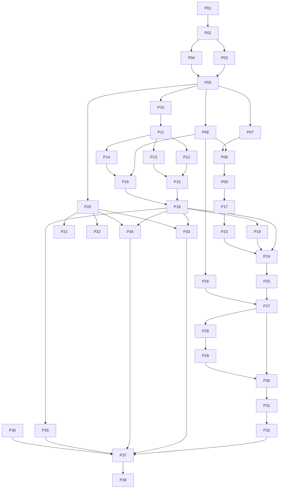

# Homebridge Rust — Implementation Plan

> **For agentic workers:** Use `executing-plans` for inline execution of the selected ticket. Steps use checkbox syntax for tracking. The owner requires **one ticket per session**, with an owner-selected model, versioned memory, and a PR. Do not delegate or automatically continue to another ticket. Read `AGENTS.md` and `docs/project-state.md` at startup.

**Goal:** Gradually replace the QNAP TS-251+ installation with a Web-administered Rust bridge while preserving io/RTS coverings, garage, heating, and existing actions.

**Architecture:** Rust core and compiled connectors, static UI, and HomeKit transport validated early. Keep the Homebridge child bridge active for functions not yet replaced. A final Node-free profile requires full inventory coverage.

**Tech Stack:** Stable Rust/2024, Tokio, Axum, serde, reqwest/Rustls, rusqlite, Svelte/TypeScript/Vite, Docker/Compose, QNAP QDK. Rust HAP after proof, using a suitable library or a project implementation; no JavaScript/TypeScript server. Browser JavaScript/TypeScript is allowed, built off-NAS and served by Rust.

**Spec:** [Architecture](../../architecture.md), [contracts](../../contracts.md), [Luna guide](../../execution-luna.md), [inventory](../../inventory-template.md).

## Global Constraints

- Priority hardware: QNAP TS-251+, Intel Celeron J1900, 2 GB; build off-NAS for generic x86_64.
- Target gateway: TaHoma V2; both io-homecontrol **and** RTS required.
- Initial visual inventory: 11 coverings, 2 thermostats, 1 garage, 9 Switch elements; 23 elements to qualify.
- Observed versions: Homebridge 2.4.0, UI 5.29.0, Node 24.21.0, homebridge-tahoma 2.2.64.
- No secrets, real gateway IDs, persistence files, or named household inventory in the public repository.
- `observe` and `legacy` prohibit Rust writes and HomeKit publication.
- Never automatically replay an uncertain physical command.
- Never present estimates as measurements or invent a closed garage state.
- `docs/contracts.md`, including queue sizes/deadlines, applies to every ticket.
- Preserve each existing use case through a known path until native validation; retaining legacy is not completed replacement.
- Docker **and** QNAP `.qpkg` delivery required; no compilation/npm on the NAS in native mode.
- Minimize server memory/CPU: one Rust process, bounded tasks/queues/buffers, event-driven updates; no Node/HAP-NodeJS sidecar. Existing Homebridge is transitional only.
- Resource comparison is deferred to final validation (P31/P38) by owner decision; no initial measurement gate in P03.
- Automated tests use fictional data; physical tests are a separate phase with the owner.
- Prefix local shell commands with `rtk` as required by the environment RTK file; CI uses native tools.
- Each session handles only the chosen ticket and leaves state in `docs/project-state.md` and a report in `docs/sessions/PXX.md`.
- All project documentation, comments, prompts, reports, and PR descriptions are written in English.

## Review Focus

1. Accepted TaHoma POST with lost response: `Unknown`, one send, no reboot replay — P15/P18.
2. External RTS remote: no fictitious confirmed position — P13/P24.
3. Spoofed gateway, wrong CA, token-bearing redirect: connection refused, no secret sent elsewhere — P11.
4. Full disk, hostile archive, schema rollback: preserve data/identities before switching — P06/P26/P32.
5. J1900-incompatible binary, duplicate QPKG service, abrupt termination: clear refusal or clean shutdown, no state loss — P28/P29.

## 1. Execution and task sizing

Each task below is a review unit, usually 0.5–1.5 days. If it exceeds one agent-day without a verifiable result, split it into 1–3 hour subtasks preserving the same contract. Agent output alone cannot complete HAP or hardware proof.

For each code ticket: read affected files/all callers → write a targeted test → observe failure for the expected reason → implement the minimum → run the specified checks → update affected documentation/fixtures → focused commit → review. Documentation tasks need no artificial tests.

Run `cargo`/`npm` commands below through `rtk cargo ...` or `rtk proxy npm ...` on this machine. New shell scripts require `sh -n` and a simulated-service scenario; never test production scripts by operating real motors.

Workspace package names are exactly `bridge-core`, `integration-tahoma`, `transport-homekit`, `bridge-server`. `cargo test -p PACKAGE --test NAME` refers to `crates/PACKAGE/tests/NAME.rs`. P17 fixes npm script names: `check`, `test`, `build`, `test:e2e`.

## 2. Dependencies and milestones

Dependencies written in individual tickets take precedence over the simplified graph. Activate P21 **or** P22 after P04; only one backend is needed for M3. P36 produces code only if other uses are discovered. P35 is mandatory: cover all nine Switch elements even if their temporary implementation stays legacy.

| Milestone | Required tickets | Authorized output |
|---|---|---|
| M0 — decisions | P01–P05 | Contracts/HAP decision; no migration |
| M1 — baseline | P06–P09, P17 | Simulator UI/API; no physical device |
| M2 — Somfy | P10–P16, P18–P19 | Local observation, then simulated command tests |
| M3 — product | P20 + P21 or P22, P23–P26 | Full flow and test bridge |
| M4 — distribution | P27–P30 | Testable Docker/QPKG; no automatic migration |
| M5 — pilot | P31–P35, P37 | Real per-family validation, 72 h stability |
| M6 — legacy removal | P36/P38 | Prove zero legacy dependency before removing Node |

## 3. Tickets

### P01 — Public repository and design documents

**Dependencies:** none. **Deliverable:** `magic5644/homebridge-rust`, public as requested by the owner, initially containing only these documents.

**Status: completed October 17, 2026 during document preparation.** [Verified repository](https://github.com/magic5644/homebridge-rust). See [current memory](../../project-state.md) for development-ticket state.

**Files:** `README.md`, `.gitignore`, `docs/**`. **Interfaces:** no product API.

- [x] Verify active account with `gh api user --jq .login` and absence of an existing same-name repository; never overwrite one.
- [x] Check relative links and search all publishable files for secrets/real identifiers; exclude `.graph-it`, local data, and private metadata.
- [x] Initialize `main`, create the public repository, publish `docs: plan Rust home automation bridge`, and verify owner, visibility, and remote commit.
- [x] Keep a design-only README status at initial delivery; do not invent an installable application.

**Completion:** accessible public URL, expected files present, no production code or private data published at initial delivery.

### P02 — Compilable workspace and validation baseline

**Dependencies:** P01; explicit P02 startup with the session prompt authorizes its minimal baseline within the proposed architecture. **Files:** `Cargo.toml`, `Cargo.lock`, `rust-toolchain.toml`, `crates/*/Cargo.toml`, `crates/*/src/lib.rs`, `crates/bridge-server/src/main.rs`, `crates/bridge-server/tests/cli_version.rs`, `docs/dependencies.md`, `scripts/check.sh`, `.github/workflows/check.yml`, `docs/sessions/P02.md`, and current memory.

**Produces:** the four packages defined above; `bridge-server --version` and `bridge-server check --config PATH`.

- [x] Pin Rust/dependency versions after consulting Context7 for relevant libraries; document licenses/exact versions without treating a version family as an exact version.
- [x] Create four packages with minimum dependencies; no plugin framework.
- [x] Add `cli_version`: output contains package version, exit 0; missing config → readable error, nonzero exit, no overwritten files.
- [x] Create `scripts/check.sh` as entry point for `cargo fmt --all -- --check`, `cargo clippy --workspace --all-targets --locked -- -D warnings`, `cargo test --workspace --locked`, `cargo build -p bridge-server --release --locked`; stop on first failure. Verify `sh -n`, a simulated failed check, and real command execution.
- [x] Run the script in CI following GitHub Actions memory: stable `Rust checks` job, PR/push main, minimum permissions, pinned actions, timeout, fictional data. Choose a code license and preserve notices for reused components.
- [x] Push a branch/create a PR, verify latest-commit CI; record commands, results, and limits in `docs/sessions/P02.md`/`docs/project-state.md`. No automatic merge/release.

**Completion:** minimal reproducible build, green CI, no home-network calls at test startup. PR evidence and integration status are recorded in [P02 report](../../sessions/P02.md); checked implementation steps do not mean merged on `main`.

### P03 — Usable inventory, baseline, and fixtures

**Dependencies:** P02; read-only access to the installation by an authorized session. **Files:** `docs/compatibility.md`, `docs/performance-baseline.md`, `fixtures/tahoma/*.json`, `tests/fixtures_manifest.json`. Real data: Git-excluded `private/`.

**Status:** partial delivery; the existing Homebridge UI and all 23 accessory dialogs were inspected read-only with owner authorization. Remaining raw capabilities and action effects are missing. Resource comparison is deferred to P31/P38 and is not a P03 completion gate. [Coverage and missing evidence](../../compatibility.md), [baseline](../../performance-baseline.md), [session report](../../sessions/P03.md). P02 integration and its exact-commit main CI were verified at startup; P03 is not complete.

**Produces:** anonymized list of 23 visible elements, distinguishing physical devices/actions, used features, and fallback paths.

- [ ] Collect QTS, Container Station, topology/ports, versions, and relevant plugin configuration; never copy secrets or `persist/` into fixtures.
- [ ] Obtain raw TaHoma setup evidence through an owner-run read-only capture or an authorized existing integration; the owner retains the token. Collect `controllableName`, commands, states, and models for io/RTS, garage, and heating profiles.
- [ ] Classify nine Switch elements; record effects and Apple Home usage. UI state is not evidence of a physical measurement.
- Deferred by owner on October 17, 2026 to P31/P38: compare legacy and Rust required processes after warmup, distinguishing host memory, RSS/PSS and cgroup. Not measured and not a P03 blocker.
- [x] Produce minimal contractual fixtures with fictional data and a manifest validating JSON, files, and absence of real identifiers. All ten are authored examples; detailed event payloads remain illustrative pending capture evidence. Offline checks and review do not establish compatibility.

**Verification:** `python3 -m json.tool FILE` for each fixture; review every use case's current path/target. Missing profiles are explicit prerequisites for their tickets, not declared support.

### P04 — Rust HomeKit decision, maximum three-day budget

**Dependencies:** P02. **Files:** `experiments/hap-proof/`, `docs/decisions/0001-homekit-backend.md`, `docs/hardware/hap-proof.md`; no committed pairing keys.

**Consumes:** pinned Rust HAP candidates and the HAP protocol requirements. **Produces:** `native-approved`, `native-build-required`, or `stop-and-review` decision plus reproducible evidence. No JavaScript backend. Existing Homebridge is only an interoperability reference/transition path.

- [ ] Targeted audit: toolchain compatibility, dependencies, persistence, permissions, test quality, maintenance needs; compile for generic Linux x86_64.
- [ ] Expose fictional switch/covering; verify discovery, pairing, reads, writes, notifications from a test controller.
- [ ] Test restart, accessory addition/removal, controller removal, malformed data, clean shutdown; obtain Apple Home evidence on a test bridge.
- [ ] Measure prototype/document every required fix. No custom cryptography or TLS/auth bypass.
- [ ] Choose P21 for a validated suitable library or P22 for native Rust HAP implementation. If no library fits, document the required protocol work, evidence, crypto dependencies and bounded implementation/review stages. The three-day budget covers evaluation/planning, not a complete new HAP stack.

**Completion:** human HAP/security review; a compiled example alone does not authorize `native-approved`.

### P05 — Shared types and invariants

**Dependencies:** P03, P04. **Files:** `crates/bridge-core/src/{model,error,event,config}.rs`, `crates/bridge-core/tests/model_contract.rs`, `lib.rs` exports; contract updates if needed.

**Consumes/produces:** every type from contract sections 1–6, exact names/serialization.

- [ ] `position_bounds`: accept 0/100, reject 101; `unsupported_command`: capability mismatch → `validation_error`.
- [ ] `quality_is_honest`: unknown has no value; estimates never become measurements; `ownership_blocks_writes` for `legacy`/`observe`.
- [ ] Implement types, errors, validation; no HTTP logic or TaHoma dependency in core.
- [ ] Run `cargo test -p bridge-core --test model_contract`, then workspace checks; save shared JSON examples.

**Completion:** consumers work without renaming interfaces at will.

### P06 — SQLite, identities, and atomicity

**Dependencies:** P05. **Files:** `bridge-core/src/store.rs`, `bridge-core/src/migrations/001.sql`, `bridge-core/tests/store_contract.rs`, `bridge-core/tests/store_failures.rs` under `crates/`.

**Produces:** contractual `Store` API, dedicated worker, directory lock.

- [ ] `identity_survives_rename_restart`: same UUID/AID/IID after rename, reorder, temporary removal, reopening; no implicit recycling.
- [ ] `revision_and_state_commit_together`, `second_writer_refused`, `idempotency_persists`, `interrupted_command_becomes_unknown` with temporary databases.
- [ ] `disk_full_preserves_previous_state`: simulate write failure; no published revision/success; old database remains readable.
- [ ] Implement tables/constraints/transactions, 64-slot queue, async API without blocking SQLite on Tokio.
- [ ] Run `cargo test -p bridge-core --test store_contract --test store_failures`; migration failure preserves/restores the old database.

### P07 — Configuration and local secrets

**Dependencies:** P05. **Files:** `bridge-core/src/config.rs`, `bridge-core/src/secrets.rs`, `bridge-core/tests/config_contract.rs`, `config.example.json`.

**Produces:** `load_config(path: &Path) -> Result<AppConfig, BridgeError>`; `save_config_atomic(path: &Path, config: &AppConfig) -> Result<(), BridgeError>`; `AppConfig` contains listen, data_dir, TahomaConfig, HomeKitConfig.

- [ ] Tests: invalid config rejected without writing, token never serialized, 0600 files/0700 directories, previous file retained after failed replacement.
- [ ] Set schema_version=1, default listen `127.0.0.1:8582`, HAP 51827; validate known conflicts without assuming ports are free.
- [ ] Load secrets from files, not URLs/command arguments; examples contain no real values.
- [ ] Run `cargo test -p bridge-core --test config_contract`; `bridge-server check` neither connects to nor modifies devices.

### P08 — Authentication and API envelope

**Dependencies:** P06, P07. **Files:** `bridge-server/src/api/{mod,auth,error}.rs`, `bridge-server/src/bootstrap.rs`, `bridge-server/tests/auth_contract.rs`, `docs/api/openapi.yaml`.

**Produces:** contractual setup/auth/health routes; database sessions, CSRF, normalized errors, limits.

- [ ] Tests: reject expired/incorrect setup code; create admin once; hash password; logout invalidates session.
- [ ] Tests: writes without session →401; missing CSRF/valid Origin →403; payload >256 KiB →413; rate-limited auth with nonrevealing errors.
- [ ] Implement Argon2id outside async workers, random sessions; no sensitive logs; 10 min setup code.
- [ ] Describe contractual routes in OpenAPI with request/response schemas and fictional examples.
- [ ] Run `cargo test -p bridge-server --test auth_contract` and a login test through a development HTTPS proxy.

### P09 — Simulated server and read API

**Dependencies:** P08, P03. **Files:** `bridge-server/src/simulator.rs`, `bridge-server/src/api/devices.rs`, `bridge-server/tests/read_api.rs`, `fixtures/api/*.json`.

**Produces:** working fixture-based `GET devices/system/integrations`, explicit `serve --simulate`; never enabled by default.

- [ ] Tests: contractual list/revision, no source IDs/tokens; unknown device stays visible without commands.
- [ ] Load fixtures into a temporary database and use the future integration's registry; no separate UI-test server.
- [ ] Run `cargo test -p bridge-server --test read_api`; frontend can consume API fixtures.

### P10 — TaHoma discovery and network identity

**Dependencies:** P05. **Files:** `integration-tahoma/src/discovery.rs`, `integration-tahoma/tests/discovery_contract.rs`.

**Produces:** contractual `discover(Duration)`, without device reads or developer-mode activation.

- [ ] Tests: expected TXT accepted; matching name with different TXT PIN rejected; multi-interface duplicates deduplicated; timeout without results → empty list.
- [ ] Browse only documented developer service; allow a manual address preserving TLS DNS name.
- [ ] Run `cargo test -p integration-tahoma --test discovery_contract` with simulated announcements; optional real mDNS test stays separate.

### P11 — TaHoma HTTP client and TLS validation

**Dependencies:** P10, P07, P03. **Files:** `integration-tahoma/src/{client,dto}.rs`, `integration-tahoma/tests/{http_contract,tls_contract}.rs`, manufacturer CA with documented provenance/fingerprint.

**Produces:** contractual `TahomaClient`/DTOs; reused client, 5 s timeout, 4 MiB setup limit.

- [ ] Tests: correct Bearer/CA → setup read; invalid token → dedicated error; wrong CA/name → failure; redirect → no second host contacted.
- [ ] Tests: ignore system proxy variables for gateway; oversized/truncated response → error, no loop; tolerate extra fields.
- [ ] Implement only setup/event/execution routes; use official verbs and encode URL segments.
- [ ] Run `cargo test -p integration-tahoma --test http_contract --test tls_contract`; no tokens in captured test logs.

### P12 — io covering mapping

**Dependencies:** P11. **Files:** `integration-tahoma/src/mapping/{mod,covering_io}.rs`, `integration-tahoma/tests/covering_io.rs`.

**Produces:** `map_device`/`encode_command` for inventoried io profiles, following contract conventions.

- [ ] Tests per anonymized real profile: closed=0, open=100, position 80, inversion only when required by manufacturer profile; no assumed global inversion.
- [ ] Select open/close/stop/position from declared commands; offer tilt only when actually available.
- [ ] Represent radio errors/missing state without substituting the last target for a measurement.
- [ ] Run `cargo test -p integration-tahoma --test covering_io` and shared projection fixtures.

### P13 — RTS and explicit estimation

**Dependencies:** P11, P12 for shared-dispatcher integration. **Files:** `integration-tahoma/src/mapping/covering_rts.rs`, `bridge-core/src/estimation.rs`, `covering_rts.rs`/`estimation_contract.rs` tests in their packages.

**Produces:** available RTS actions; estimates only after per-device calibration.

- [ ] `rts_without_feedback_is_unknown`: no manufacturer state → unknown position, not default 0/100; commands remain limited to actual support.
- [ ] Without calibration, reject `SetPosition` if hardware cannot perform it; retain declared open/close/stop.
- [ ] If intermediate position is an existing use case, implement separate up/down durations, monotonic clock, bounds, and invalidation after reboot/tracking loss; simulated-time tests, no motor.
- [ ] `external_remote_invalidates_estimate`: events/control uncertainty remove confirmation; UI explains unobservable-remote limits.
- [ ] Run `cargo test -p integration-tahoma --test covering_rts` and `cargo test -p bridge-core --test estimation_contract`.

**Completion:** no automatic calibration movement; retain legacy if current intermediate-position use cannot be reproduced honestly.

### P14 — Event stream and reconciliation

**Dependencies:** P11, P06. **Files:** `integration-tahoma/src/events.rs`, `integration-tahoma/tests/events_contract.rs`.

**Produces:** async `run_events(client: TahomaClient, store: Store, cancel: CancellationToken)`, returning `Result<(), BridgeError>`; consistent availability/snapshots, Store publication.

- [ ] Simulated-clock tests: maximum one fetch/second; invalid listener/reboot → register again; read failures → jittered 1..30 s backoff.
- [ ] Test setup/registration gap: reconciliation recovers state; added/removed/unknown devices do not crash the stream.
- [ ] Healthy unchanged stream retains confirmed state; failed stream >30 s → stale data; refresh before confirmation after recovery.
- [ ] Run `cargo test -p integration-tahoma --test events_contract`; cancellation releases reachable listener without delaying shutdown beyond 10 s.

### P15 — Manufacturer execution and uncertain outcomes

**Dependencies:** P12, P13, P11. **Files:** `integration-tahoma/src/commands.rs`, `integration-tahoma/tests/command_transport.rs`.

**Produces:** contractual `execute`/`execution`; no automatic POST retry.

- [ ] Simulator accepts POST then closes connection → one send/uncertain result; never an implicit reqwest retry.
- [ ] Test manufacturer rejection, failed execution, acceptance without physical state, late event; HTTP 200 alone does not produce `Succeeded`.
- [ ] Map only documented/observed results; tracking bounded to 120 s, then `Unknown` if outcome unproven.
- [ ] Run `cargo test -p integration-tahoma --test command_transport`; redact sensitive parameters.

### P16 — Daemon orchestration and health

**Dependencies:** P06–P09, P14. **Files:** `bridge-server/src/{runtime,health,main}.rs`, `bridge-server/tests/lifecycle.rs`.

**Produces:** Store/connector/API assembly, shared cancellation, health state.

- [ ] Tests: missing gateway at startup → usable API, ready=200 if storage ready/integration degraded; unusable database → ready=503.
- [ ] SIGTERM closes admission, stream, worker in ≤10 s, including open SSE and blocked manufacturer request.
- [ ] One supervisor per integration; show permanent errors without aggressive restart.
- [ ] Run `cargo test -p bridge-server --test lifecycle`; track/cancel every spawned task.

### P17 — Static UI and browser contract

**Dependencies:** P09. **Files:** `web/package.json`, lockfile, Svelte/Vite/TypeScript configuration, `web/src/{App.svelte,lib/api.ts,lib/types.ts}`, `bridge-server/src/assets.rs`, frontend read tests.

**Produces:** embedded static build; npm scripts from section 1.

- [ ] Consume `fixtures/api` examples; tests for snapshot/error reading, unknown-state display, no sensitive data.
- [ ] Same-origin client, session cookies, CSRF forwarding; no localStorage tokens.
- [ ] Embed compiled assets, correct MIME types; unknown `/api` routes must not become `index.html`.
- [ ] Run `npm ci`, `npm run check`, `npm test`, `npm run build` in `web/`, then binary asset-serving test; no Node for production serving.

### P18 — Shared command router and idempotency

**Dependencies:** P15, P16. **Files:** `bridge-core/src/command.rs`, `bridge-server/src/command_router.rs`, `bridge-server/src/api/commands.rs`, `bridge-server/tests/command_router.rs`.

**Produces:** contractual `CommandRouter::submit`/command routes; `CommandEnvelope` for HomeKit.

- [ ] Tests: native accepts; observe/legacy rejects without manufacturer call; invalid capability/value rejected; unavailable device →503.
- [ ] Duplicate request_id/identical content → same command_id/one send; same ID/different content →409; preserve across reboot.
- [ ] Queue=32, one ordinary active command/device; saturation →429, no unbounded tasks; wait >5 s → cancel before transmission/recheck ownership then.
- [ ] `stop_interrupts_pending_position`, `stop_allowed_while_moving`: priority stop, cancel unsent position; never falsely report a sent command physically cancelled.
- [ ] Crash after admission/send: uncertain operations → `Unknown`, no automatic replay; run `cargo test -p bridge-server --test command_router`.

### P19 — Bounded SSE and slow clients

**Dependencies:** P18. **Files:** `bridge-server/src/api/events.rs`, `bridge-server/tests/sse_contract.rs`, `web/src/lib/events.ts`, associated tests.

**Produces:** contractual events, 15 s heartbeat, 16-client limit.

- [ ] Tests: disconnected/reconnected client gets snapshot; >256-event lag → resync; 17th client →429.
- [ ] Notify only after Store commit; cookies/session required; close on logout/expiration/server shutdown.
- [ ] Run `cargo test -p bridge-server --test sse_contract`, then frontend simulated disconnect/reconnect tests; no unbounded browser accumulation.

### P20 — Backend-independent HomeKit projection

**Dependencies:** P05, P06, P12, P13. **Files:** `transport-homekit/src/projection.rs`, `transport-homekit/tests/projection_contract.rs`, `fixtures/homekit/*.json`.

**Produces:** stable devices/capabilities → services/characteristics projection consuming persistent UUIDs/AID/IID.

- [ ] Tests: publish only native devices; rename/restart/reorder preserve IDs; 150th device behind a bridge → explicit rejection or previously planned group.
- [ ] Unknown position → communication error on read instead of invented value; honor read/write permissions, no read-only modification.
- [ ] Verify closed=0/open=100 with identical API/Somfy fixtures and resync after lost event.
- [ ] Run `cargo test -p transport-homekit --test projection_contract`; projection alone never calls a motor.

### P21 — Rust HAP backend, if approved

**Dependencies:** P04=`native-approved`, P20, P18, P19. **Files:** `transport-homekit/src/{lib,native}.rs`, `native_contract.rs` tests, targeted HAP-fork adaptations if needed.

**Produces:** contractual `transport_homekit::run`, connected to the same router as Web.

- [ ] Turn P04 evidence into contract tests including persistence, revocation, notifications, hostile data; use the pinned stack API.
- [ ] Each HomeKit write becomes a CommandRequest; prompt admission response, separate physical-outcome tracking; reads use cached state.
- [ ] Run `cargo test -p transport-homekit --test native_contract`, workspace checks, then Apple Home with a fictional bridge.

**Completion:** traceable HAP version/fixes; no Node dependency in native profile.

### P22 — Native Rust HAP implementation, if no suitable library exists

**Dependencies:** P04=`native-build-required`, P20, P18, P19. **Files:** `transport-homekit/src/{lib,native}.rs`, native HAP modules and protocol/interop tests, `docs/decisions/0001-homekit-backend.md`, `docs/hardware/hap-proof.md`.

**Produces:** the same native `transport_homekit::run` interface as P21, implemented in Rust with minimum server memory/CPU overhead. No Node process or JavaScript/TypeScript server.

- [ ] Turn P04's gap analysis into bounded implementation stages before writing protocol code; retain explicit evidence for what is implemented and what remains unvalidated.
- [ ] Implement discovery, pairing/verification, encrypted sessions, characteristic permissions, reads/writes/notifications, revocation and persistent identities. Reuse maintained cryptographic libraries for primitives; do not invent cryptography.
- [ ] Test known protocol vectors, malformed/hostile inputs, counters/session limits, persistence, revocation, disconnect/reconnect and shutdown. Use bounded resources and integrate with the existing Store/router; uncertain physical commands are not replayed.
- [ ] Validate Apple Home interoperability with fictional accessories and obtain human HAP/security review before production use. Incomplete conformance is not compatibility proof.
- [ ] Run native transport contract tests and workspace checks; measure the complete Rust process during final validation. Report gaps without introducing a Node fallback.

**Completion:** validated native Rust transport, traceable dependencies/protocol evidence, passing interoperability and security review. A protocol implementation is planned here, not claimed as delivered by the P03 documentation update.

### P23 — Login and TaHoma setup UI

**Dependencies:** P17, P11, P08. **Files:** `web/src/pages/{Setup,Login,Integrations}.svelte`, `web/tests/setup.spec.ts`.

**Produces:** first account → login → TaHoma test → observe-mode inventory reading.

- [ ] E2E: wrong token/CA shows useful error, never redisplays token; success lists devices without automatic commands/publication.
- [ ] Accessible fields, French UI, token paste supported; warn before leaving an unsaved form.
- [ ] Run `npm run check`, targeted tests, `npm run test:e2e -- setup.spec.ts` on HTTPS simulator; no real equipment.

### P24 — Devices and commands UI

**Dependencies:** P23, P18, P19. **Files:** `web/src/pages/Devices.svelte`, `web/src/components/{DeviceCard,CommandStatus}.svelte`, `web/tests/devices.spec.ts`.

**Produces:** controls determined by capabilities/ownership/availability; execution state separate from physical state.

- [ ] E2E: native commands allowed, observe/legacy blocked; unknown/stale/estimated states identified by text, not color alone.
- [ ] Double-click reuses request_id during admission; new intentional action gets new ID; network errors never cause automatic retransmission.
- [ ] Show RTS calibration/limits only for relevant profiles; no automatic physical calibration.
- [ ] Run `npm run test:e2e -- devices.spec.ts`, keyboard/mobile checks, and no-feedback state-component tests.

### P25 — HomeKit, settings, diagnostics UI

**Dependencies:** P24, P20, P21 or P22. **Files:** `HomeKit.svelte`, `Settings.svelte`, `Diagnostics.svelte`, `web/tests/administration.spec.ts`, corresponding `bridge-server/src/api/` routes.

**Produces:** active backend, restricted pairing, service metrics, redacted logs, legacy administration links.

- [ ] Tests: no QR/PIN without session, no-store, never logged; maximum 500 lines and giant-message truncation.
- [ ] Show product RSS and its limits; do not describe NAS free RAM as product consumption.
- [ ] No update button improvising shell commands; provide installation-specific instructions and backup link.
- [ ] Verify routes with HTTP tests and `npm run test:e2e -- administration.spec.ts`.

### P26 — Safe backup and restoration

**Dependencies:** P06, P07, P08. **Files:** `bridge-core/src/backup.rs`, `bridge-server/src/cli/backup.rs`, `bridge-server/src/api/backups.rs`, `bridge-core/tests/backup_contract.rs`, `docs/operations/backup.md`.

**Produces:** versioned manifest, consistent SQLite backup, Web validation; apply through local CLI while stopped.

- [ ] Tests: full restore preserves the new product's identities/pairings; Web backup excludes sessions/secrets and lists values to reenter.
- [ ] Reject traversal, symlinks, archive bombs, bad checksums, >1,000 entries, >50 MiB compressed/>200 MiB extracted, future schemas.
- [ ] Validate in temporary directory, back up prior state, replace atomically; failure injection leaves old state usable.
- [ ] Run `cargo test -p bridge-core --test backup_contract` and a temporary-directory CLI cycle; never use current Homebridge installation.

### P27 — Docker image and Compose for QNAP

**Dependencies:** P25, P26, selected backend operational. **Files:** `packaging/docker/Dockerfile`, `compose.yaml`, `.dockerignore`, `docs/install/docker-qnap.md`, `tests/packaging/docker-smoke.sh`.

**Produces:** image without runtime compilation, `/data` volume, configurable user, Linux host networking, internal healthcheck.

- [ ] Smoke: read-only root, cap-drop ALL, no privileged/Docker socket; persistence after recreation, SIGTERM ≤10 s, offline gateway does not fail live health.
- [ ] Valid `docker compose config`; no `ports:` with host networking; explicit UI binding/free HAP ports.
- [ ] Build/run amd64; also run arm64 on native runner or explicitly identified emulation, not claimed as an arm64 NAS test.
- [ ] Document Container Station installation compatible with P03 QTS version, directory permissions, HTTPS reverse proxy.
- [ ] Run `sh -n tests/packaging/docker-smoke.sh`, then smoke in test environment; no automatic production NAS deployment.

### P28 — J1900-compatible native archive

**Dependencies:** P27. **Files:** `packaging/native/build.sh`, `packaging/native/README.md`, `tests/packaging/native-smoke.sh`, necessary target configurations.

**Produces:** generic `linux-x86_64` archive, embedded UI, SHA-256 checksums; secondary arm64 archive if CI available.

- [ ] Check libc/kernel/crypto/multicast resolution; compare musl/glibc on target and document a QTS-working variant.
- [ ] Tests: no `target-cpu=native`, `--version`, `check`, `serve --simulate`, persistent storage, clean shutdown without Node/npm/Rust installed on test host.
- [ ] Real J1900 smoke before compatibility claim; clear error for incompatible instructions/kernel, never a binary tested only on the developer's Mac.
- [ ] Check shell syntax, artifact, checksum, shutdown protocol; install only in an isolated test directory.

### P29 — QNAP `.qpkg` package

**Dependencies:** P28, QTS version from P03. **Files:** `packaging/qnap/{qpkg.cfg,package_routines,shared/homebridge-rust.sh}`, build script, `tests/packaging/qpkg_service.sh`, `docs/install/qpkg.md`.

**Produces:** QDK x86_64 package with start/stop/restart/status, data outside directories replaced during upgrade.

- [ ] Read current QDK docs/pin version; no developer volume paths in package.
- [ ] Simulated service: start twice → one process; reused PID → do not kill another program; stop waits/handles a stuck daemon without destroying data.
- [ ] Test install/upgrade/disable/reboot/uninstall on test QTS or with owner; retain data and explicit deletion rules.
- [ ] Minimum privileged installation, then daemon under service account; verify `/data` permissions/ownership.
- [ ] Verify `sh -n`, `sh tests/packaging/qpkg_service.sh`, QDK metadata, real artifact. Document signing/App Center approval; never automatically disable NAS protections.

**Completion:** simple manual installation demonstrated on TS-251+; no promise of automatic QNAP catalog listing.

### P30 — Release CI and traceability

**Dependencies:** P27–P29. **Files:** `.github/workflows/{check,release}.yml`, `docs/release.md`, `CHANGELOG.md`.

**Produces:** PR tests, multiarch Docker/archive/QPKG builds, notes, licenses, checksums, component inventory.

- [ ] PRs run tests/builds without publication or secrets available to forks; minimal GitHub permissions.
- [ ] Approved tag publishes immutable GHCR version/digest; actually verify anonymous access, since public repository does not guarantee public GHCR package.
- [ ] Include the actual Rust/UI dependency licenses and notices for redistributed components; no legacy Homebridge/HAP-NodeJS dependency is implied and no logo reuse as official branding.
- [ ] Validate workflow with test version; no stable release before P37. Signing credentials remain outside repository.

### P31 — Comparable measurements and simulated endurance

**Dependencies:** P30, P03, selected backend. **Files:** `tests/performance/`, `docs/performance-results.md`, anonymized results.

**Produces:** reproducible report with versions, hardware, exact scope.

- [ ] 50/100-device scenarios: idle, state burst, 5 clients/1,000 reads, slow client, reconnects, maximum queue sizes.
- [ ] During final validation, collect comparable legacy and Rust windows after warmup on identical hardware/functions before removing the legacy installation. The initial baseline was explicitly deferred from P03 by the owner; no earlier sample series is assumed.
- [ ] Report RSS/PSS, separate cgroup metrics, CPU, API/admission p95, startup, memory peak; include retained legacy processes while required.
- [ ] 72 h endurance: no crash, stable task/file counts, memory plateau/drift <10% per architecture.
- [ ] Compare targets: 64/128 MiB native RSS, proposed 50% household gain; if missed, profile the measured bottleneck and create a focused fix.

**Completion:** raw measurements kept locally, public summary without topology/names; no unmeasured gain claim.

### P32 — Observed migration and verified rollback

**Dependencies:** P31, P26, P03. **Files:** `bridge-server/src/api/ownership.rs`, `docs/operations/{migration,rollback}.md`, `bridge-server/tests/ownership_migration.rs`, migration UI.

**Produces:** expected_revision-protected transition and migration checklist; no automatic remote Homebridge changes.

- [ ] Test legacy→observe→native with correct revision; conflict →409; reverting to observe stops admission/publication without erasing IDs.
- [ ] After ownership change, reconcile HomeKit/UI and cancel unsent commands; sent commands become uncertain if no longer tracked. Test ownership changes while queued.
- [ ] Simulate rollback to an old version with compatible backup and reject silently reading a future schema.
- [ ] Rehearse rollback on a test bridge; document Apple room/scene/pairing recovery limits.

### P33 — Somfy garage door, required work

**Dependencies:** P03, P18, P20, P24; human supervision before physical tests. **Files:** `integration-tahoma/src/mapping/garage.rs`, `garage_contract.rs` tests, `transport-homekit/src/projection.rs`, UI component, `docs/compatibility/garage.md`.

**Consumes:** exact model, commands, available state/obstruction feedback, io/RTS type, current plugin cyclic configuration. **Produces:** honest control equivalent to the accepted use case.

- [ ] Qualification subtask: declared command → effect, state → physical evidence; observe without operating. If only pulses exist, do not implement deterministic open/close commands.
- [ ] `unknown_is_not_closed`, `no_fake_obstruction`, `cyclic_is_not_open_close`, `no_replay_after_timeout`; never infer closure from elapsed time.
- [ ] Case A: sufficient state/safety → validated GarageDoorOpener reads/commands. Case B: distinct momentary buttons only when proven/accepted, unknown-state display. Case C: retain legacy and identify missing sensor/API.
- [ ] Verify connector/core/projection/UI tests; simulation does not validate mechanical safety.
- [ ] With owner, validate Apple Home/remote control, stop/obstruction using manufacturer procedure, network loss; no improvised obstruction tests.

**Completion:** written profile acceptance; not natively complete while garage remains legacy.

### P34 — Two thermostats, required work

**Dependencies:** P03, P18, P20, P24. **Files:** `integration-tahoma/src/mapping/heating.rs`, `heating_contract.rs` tests, heating projection/UI, `docs/compatibility/heating.md`.

**Produces:** functions actually used on both heating profiles, without fictitious temperature.

- [ ] Qualify actual thermostat, pilot-wire radiator, or mode-only device; collect setpoints/modes/bounds/sensor/override durations.
- [ ] Tests: missing sensor → unknown temperature; invalid bounds/step rejected; undeclared mode refused; TaHoma changes propagated.
- [ ] If modes beyond `SetSetpoint` are needed, explicitly extend contract with the minimum enum of actually observed modes; update router/API/UI/HomeKit/fixtures together.
- [ ] Verify mapping/projection/E2E; check real outcome with owner without modifying existing heating programs.

**Completion:** two devices covered or documented limit with legacy retained; no fake 0 °C to fill mandatory HomeKit fields.

### P35 — Nine Switch elements and scenarios, required work

**Dependencies:** P03, P18, P20, P24; do not assume Switch elements are physical. **Files:** `docs/compatibility/actions.md`, dedicated fixtures, model/API/UI files only as required by selected profile.

**Produces:** nine rows with effect, dependencies, command path, result, coverage.

- [ ] Qualify each Switch as TaHoma scenario, command group, physical device, or other; record included closures/heating/garage.
- [ ] Look for a local scenario API only in official sources/on installed firmware; no guessed endpoints or simulated success.
- [ ] For a fully known static group, propose a minimal local group reusing CommandRouter; define `ActionGroup`, per-action result, partial failure, limits, and update contracts before code. Never claim atomic execution.
- [ ] For manufacturer logic/schedules or uncovered API, retain the Homebridge Switch; do not implicitly recreate an automation engine.
- [ ] Tests: partially rejected group → partial report, no automatic physical compensation; network retry never triggers twice; garage actions respect P33.

**Completion:** every use case works; distinguish native replacement from legacy retention. P38 stays blocked while any use requires legacy.

### P36 — Other uses and integration-addition protocol

**Dependencies:** P03 inventory and owner validation for new use cases. **Files:** `docs/compatibility.md`, one ticket per discovered family.

**Produces:** exhaustive coverage without proactively adding all home-automation protocols.

- [ ] Check other plugins, cameras, Matter, sensors, automations outside the 23 visible elements; documented absence → no-code task.
- [ ] For every actual need: capture anonymous fixture, define capabilities/commands/errors, contract tests, minimum connector, UI/HomeKit/hardware validation, rollback.
- [ ] Name files/interfaces/tests before assigning a ticket to Luna; do not assign generic Zigbee support without a specific coordinator/devices.

**Completion:** no inventory row without an owner/working path; scope may remain 23 if confirmed.

### P37 — QNAP acceptance and household trial

**Dependencies:** P32–P36, selected backend, Docker/QPKG P27/P29; owner-agreed window. **Files:** `docs/acceptance.md`, private detailed report if needed.

- [ ] Install in observe mode on distinct volume/ports; compare for at least 24 h without touching current publication.
- [ ] Pilot io then RTS if present, followed by heating/garage/actions after their work is validated; record re-pairing/rebuilt automations.
- [ ] Test Apple Home/Siri, wall remote, Internet loss, LAN loss, gateway reboot, QNAP reboot, application stop; no command replay.
- [ ] Demonstrate Docker/QPKG install/upgrade/stop on actual QTS; only one instance owns each device.
- [ ] Observe 72 h after the last relevant code/config change; compare memory under identical load, including all retained processes.
- [ ] Record bugs/results per use case; rerun affected scenarios after fixes, then revalidate endurance if resources/reliability are affected.

**Completion:** all inventoried uses retained, proven rollback, disclosed limits; beta release possible, all-native claim only after successful P38.

### P38 — Gradual legacy removal and all-Rust edition

**Dependencies:** P37, all necessary rows native, validated native HAP transport. **Files:** `docs/compatibility.md`, `docs/performance-results.md`, packaging, release notes.

- [ ] Verify zero residual dependency on nine Switch elements, two thermostats, garage, coverings, P36 uses; even one legacy row prevents removing its plugin.
- [ ] Back up/disable legacy paths by group with owner; retain rollback procedure/private archive.
- [ ] Verify server and HomeKit transport are Rust-only with no Node/JavaScript/TypeScript server dependency; browser JavaScript/TypeScript is permitted. Native HAP implementation and review must be complete before legacy removal.
- [ ] Measure final installation against comparable legacy measurements collected during final validation; publish actual gains and remove unused dependencies. No hybrid Node profile is offered.
- [ ] Stable tag only after covered-scope acceptance; no universal Homebridge-ecosystem compatibility claim.

## 4. Luna session organization

By default, sessions run sequentially, each on one ticket/branch. Domains below help locate affected files; they launch no parallel agents. If the owner explicitly requests concurrent sessions, use isolated workspaces and reserve shared files.

| Track | Sequential tickets | Main owned files |
|---|---|---|
| Luna baseline | P06–P09, P16, P18–P19 | bridge-core/store and bridge-server |
| Luna TaHoma | P10–P15, then P33–P35 | integration-tahoma and manufacturer fixtures |
| Luna UI/distribution | P17, P23–P30 | web and packaging |
| Integration/review lead | P04–P05, P20–P22, P31–P32, P37–P38 | contracts, HAP, cross-cutting review |

P17 waits for P09. P18 waits for P15/P16. P33–P35 run sequentially when modifying the same dispatcher. P21/P22 are alternatives, not two implementations to build immediately.

An agent must not edit shared contracts/exports/lockfiles concurrently with another. Propose changes to the lead, who reserves files and updates every consumer. Every PR includes a behavior-demonstrating test and a list of covered devices/capabilities. Session reports/current memory let the next ticket resume without chat history.

## 5. Startup conditions and remaining decisions

The documents provide an actionable breakdown. Before integration development, review scope/targets, complete P03 for exact profiles, then decide P04. These checks avoid assigning Luna an integration with unknown API/hardware.

Still needed: remaining kernel/plugin facts, exact garage modes, state/obstruction feedback, models/commands of both heating devices, contents of nine actions, any Matter functions, authenticated TaHoma inventory. Keep this data local; only anonymized technical summaries extend the public plan.
